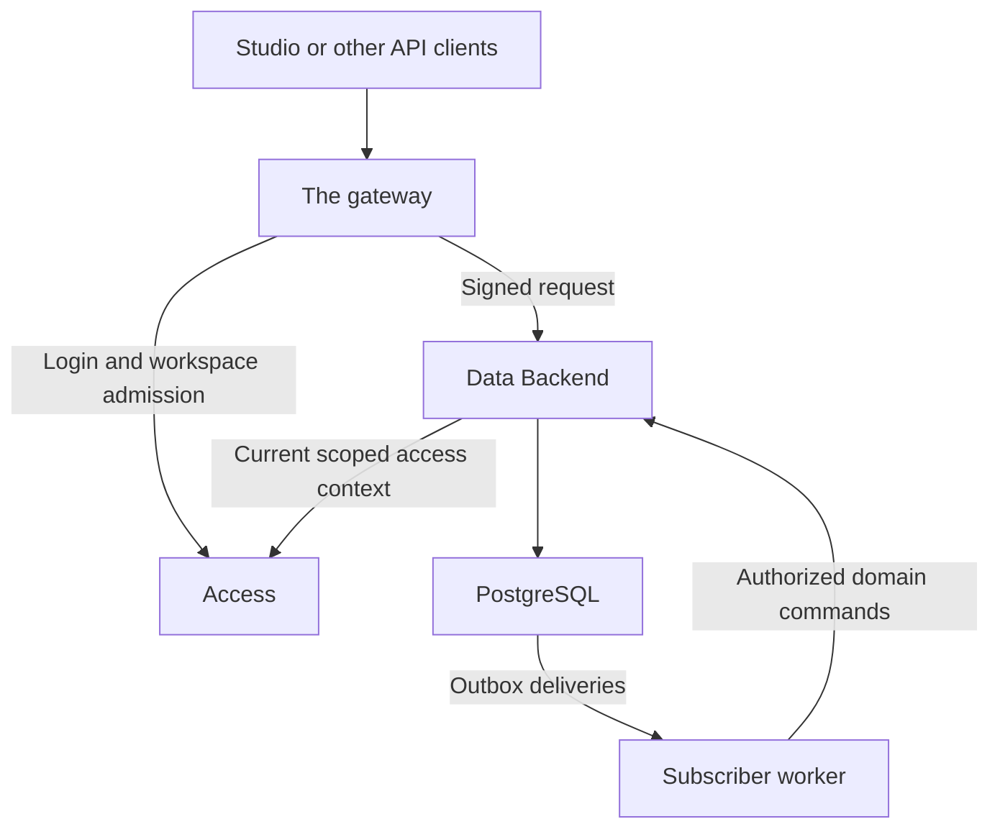

# Specification

The normative contract of Data: what the service owns, how it trusts the gateway and Access, and the rules for workspaces, schema, authorization, the HTTP API, mutations, events and operations. It is written for implementers and reviewers.

Status: 1.0.0. Runtime: TypeScript on Bun, Hono at the HTTP boundary, PostgreSQL in production. Delivery: a standalone backend repository and deployable; Studio is a separate project.

The keywords MUST, MUST NOT, SHOULD, SHOULD NOT and MAY have their RFC 2119 meaning. A capability marked deferred is outside the release, and the service MUST NOT advertise it as available. The JSON examples are illustrative configuration and protocol fixtures; they do not describe features of the gateway or Access that do not exist.

## Terms

| Term | Meaning |
| --- | --- |
| Principal | The caller, identified by the UUID of an Access principal. The gateway carries it as the identity subject. |
| Tenant | An Access tenant. Every workspace belongs to exactly one. |
| Workspace | The unit of isolation: a registry entry that names its tenant. Every business row carries its tenant and workspace. |
| Binding | A trusted route binding: the deployer's description of one gateway route and how its signatures are verified (§4.1). |
| Access context | Access's current, complete answer about a principal's permission keys for one tenant, workspace and route (§5). |
| Request context | The verified principal, tenant, workspace, route, permission keys and deadline every domain operation receives (§6.2). |
| Manifest | The deployment's declaration of its collections: keys, tables, fields, relations, search and history (§7.1). |
| Collection | A registered business table described by the manifest. |
| Catalog | The collections a workspace serves and the policy bundle that applies to it (§7.5). |
| Workspace model | A workspace's logical overlay on the deployment manifest (§7.6). |
| Policy bundle | The policies that say what each permission key grants per collection and action (§8). |
| Validator | A record's strong `ETag` (§9.4). |
| Receipt | The answer to a create, keyed by its idempotency key (§9.6). |
| Outbox event | The domain event a committed mutation writes in its own transaction (§11.3). |
| Delivery | The state of one event for one trusted subscriber (§11.5). |

## 1. Purpose and authority

Data gives applications behind the gateway reusable, permission-aware data APIs. Access is its authority for principals, tenants, groups and grants. Data owns workspaces, registered collections, record operations, data policies, audit history and committed domain events.

### 1.1 Integration baseline

<!-- compatibility-baseline:start -->

The baseline of the integration is the one of `compatibility.json`: the
one file of the platform that owns the workspaces of the three services
and the revision of the repository that is tested against them.

| Workspace | Path | The revision it is tested against |
| --- | --- | --- |
| The gateway | `packages/gateway` | `dc3d421a5f490594fe012d04eaaef21733736563` |
| Access | `packages/access` | `dc3d421a5f490594fe012d04eaaef21733736563` |
| Data | `packages/data` | the tree of the run |

<!-- compatibility-baseline:end -->

The baseline is a repository revision and never changes in place: a new baseline means a new manifest and a new run of the compatibility harness. Earlier baselines are historical evidence of past Data releases; they stay in the release notes and are not active.

### 1.2 Ownership

| Owner | Responsibility |
| --- | --- |
| Identity provider | Authenticating the external identity. |
| Access | Login, principals, tenants, groups, permission keys and scoped grants. |
| Gateway | Sessions, caller credentials, workspace admission, gateway limits, and forwarding with the signed identity. |
| Data | Verifying the upstream identity, tenant and workspace scope, current grants, record and field policies, and the data APIs. |
| Studio (separate project) | The browser application: navigation, forms, tables, dashboards and preview. |
| Other clients | Websites, application servers and scripts that consume the headless API. |

Access's tables are private to Access. Data MUST NOT query or mutate them, expose them as collections, or keep a second directory of identities and grants.

### 1.3 Headless boundary

The service MUST:

1. expose versioned HTTP APIs and machine-readable schema metadata,
2. work without Studio installed, running or reachable,
3. serve independent clients through the same domain operations and authorization rules,
4. publish an OpenAPI description and a small typed client package.

The service MUST NOT serve a studio application, login page, dashboard, form renderer, theme system, visual workflow editor or web preview. It MUST NOT depend on any Studio repository, package, origin or release.

Collection metadata may carry semantic labels and descriptions. Widget identifiers, component implementations, layouts, navigation state and presentation preferences belong to Studio, and policy validation and evaluation MUST NOT depend on them.

## 2. Scope and invariants

### 2.1 Release capabilities

| Capability | Required behavior |
| --- | --- |
| Gateway | Verify `v5` gateway identities with the gateway's public key and map verified requests to trusted route bindings. The legacy `v4` format is a migration path: a deployment that still uses it declares so with `DATA_LEGACY_IDENTITY`, and the service refuses it by default. |
| Access | A current, authoritative access context through the §5 contract. |
| Workspaces | Workspace ownership and enabled or disabled state. |
| Collections | Declarative collection manifests backed by reviewed SQL migrations. |
| Catalog | The collections a workspace serves and its policy bundle, without changing the physical schema. |
| Metadata | Collection, field, relation and action metadata, filtered by policy. |
| Records | Create, list, read, update and delete, with bounded queries and optimistic concurrency. |
| Aggregates | Groups over the rows a list would read, with the same predicates and filter. |
| Authorization | Tenant and workspace isolation, action permissions, row predicates, field visibility and write checks. |
| Audit | Committed mutations, in an append-only log. |
| Events | An outbox event per mutation, delivered to the subscribers the deployment registered. |
| Client | OpenAPI, versioned errors and a typed client that uses the caller's credentials and fetch. |
| Operations | Probes, bounded resources, metrics, logs, migrations, backups and drain. |

### 2.2 Deferred capabilities

| Capability | Integration boundary |
| --- | --- |
| Files and media | An asset domain: bytes in object storage, metadata and authorization here. |
| Drafts, publication, editorial revisions, translations | A content domain using the same authorization and transactions. The audit is not a revision store. Record version history is not deferred: it is a bounded backend capability (§11.6). |
| Public realtime subscriptions | A subscription domain over committed events, with continuing authorization and revocation. |
| Webhooks, schedules, workflows | Delivery and job domains over outbox events, with the explicit authority of a service principal. |
| GraphQL | Another transport over the same query and command services. |
| Bulk writes and exports | Bounded operations with the same row and field rules and no privileged query path. Aggregates and searches are the exceptions: they are bounded and use the same rules. |
| Runtime schema editing | A versioned schema-management contract and a reviewed migration workflow. The catalog is a logical registry: it never creates or alters a table. |
| Policy editing over HTTP | Publishing a bundle is an operator command. An endpoint that writes policies would be an authority that bypasses Access. |
| Marketplace extensions | An explicit execution and trust model. Only code the deployer registered is allowed. |
| MCP and AI features | Clients and adapters that invoke the authorized domain operations. |
| Other database engines | Storage adapters, once their transaction, isolation and query semantics are specified. |
| Studio and visual analytics | An external client project, outside the implementation and the release criteria. |

A deferred endpoint MUST be absent; it is never a successful placeholder. The service MUST NOT claim Directus parity.

### 2.3 Invariants

1. No business data operation starts without a trusted principal and a resolved workspace and tenant context.
2. A workspace belongs to exactly one Access tenant, and that ownership never changes.
3. Authentication, workspace admission and data authorization are three separate checks.
4. An enabled workspace plus an Access grant does not imply access to every collection or action.
5. Forwarded roles and e-mail addresses are never authoritative data permissions.
6. A missing context, an unavailable dependency, an unknown policy and an incomplete capabilities answer all fail closed.
7. Every business record query is scoped by tenant and workspace, including relation lookups and validation queries.
8. Client input never chooses a tenant, changes a workspace's owner, chooses a SQL identifier, supplies server audit fields, or executes SQL.
9. A committed business record mutation carries its audit entry and outbox event in the same PostgreSQL transaction.
10. Clients, internal subscribers and future transports use the same authorization services.
11. No runtime role can bypass the isolation policies.
12. Background execution has its own explicit authority: a user's headers are never reusable credentials.

## 3. Topology



The simple deployment has tenant-specific gateway deployments in front of one shared Access and one shared Data. Access's shared-client topology also works when it is configured explicitly and covered by the compatibility tests.

Data does not change how the gateway selects an identity provider. Ingress to the data endpoints MUST be restricted to the gateway's configured trust boundary. TLS termination is the deployment's responsibility.

Workspace paths are `/ws/{workspaceId}/v1/...`. The gateway preserves the request path, and Data MUST accept all of it: it MUST NOT assume the gateway strips `/ws/{workspaceId}` or an upstream base path. A deployment with an upstream base path includes it in its router and its binding, and the signature is verified against the path as received.

Probes and metrics have their own endpoints (§15.1). Data has no public login, logout, password or token endpoint.

## 4. Gateway trust contract

### 4.1 Trusted route bindings

The deployer supplies an immutable configuration entry for every accepted gateway route. The file format is in [Configuration](configuration.md#bindings-file).

| Field | Meaning |
| --- | --- |
| `id` | Local route name, for diagnostics. |
| `host` | The exact signed public authority, with the port when there is one. |
| `upstreamPathPattern` | The path Data receives, with the workspace parameter. |
| `routeId` | Access route scope for this route. |
| `identity` | How the route's signatures are verified: version, algorithm and key file. |
| `expectedTenantId` | Optional restriction for a tenant-specific gateway. |

The three `identity` values belong together:

| Version | Algorithm | Key file | Meaning |
| --- | --- | --- | --- |
| `v5` | `ES256` | `publicKeyFile` | The gateway's P-256 public key. The gateway holds the private key. |
| `v4` | `HS256` | `identityKeyFile` | The gateway's legacy derived key. It is a signing-capable secret and a migration path only. |

Rules:

1. Version, algorithm and key file MUST agree. A binding whose algorithm does not belong to its version, or whose key file is the wrong kind, is refused.
2. Data MUST NOT infer the version, algorithm or key from a request, a header, or a fallback after a failed verification.
3. A `v5` route MUST refuse `v4`, and a legacy route MUST NOT accept a public key as its secret.
4. Bindings MUST be unambiguous over signed host, received path and verifying key. An ambiguity stops startup.
5. The file is `{"version":2,"bindings":[...]}` and holds at most 100 bindings.
6. `host` is a lowercase ASCII DNS authority, with the port when required.
7. `upstreamPathPattern` holds literal path segments, exactly one `{workspaceId}` segment and a terminal `/*`. It accepts no executable regex and no other substitution.
8. A UUID segment cannot hold encoded separators, backslashes or dot segments.
9. Data verifies the original signed bytes before it uses any normalized routing value.

A version 1 bindings file held one derived identity key per binding. Data reads it as legacy mode, and a deployment that reads it must declare so with `DATA_LEGACY_IDENTITY`. The legacy format is refused by default, and version `2.0.0` removes it.

The gateway does not forward a signed `routeId` or tenant identifier. Data MUST derive the route from the matching binding, and MUST NOT accept a client-supplied route, a tenant header or an unverified claim in its place.

### 4.2 Identity verification

For every data request, Data MUST:

1. identify candidate bindings from the received path and the signed forwarded host,
2. reject missing, duplicated, malformed and conflicting identity headers,
3. require `x-gateway-signature` with the route's `v5=` prefix, and refuse every other version,
4. rebuild that version's exact canonical payload from the received method, received path, raw query string, forwarded host, subject, workspace, optional e-mail and sorted roles,
5. verify the detached JWS with the route's public key, allowing only `ES256` and type `gateway-identity` in the protected header; the payload MUST be detached, and an unknown critical header MUST be refused,
6. validate and normalize the principal and workspace identifiers only after verification,
7. require the signed workspace to equal the path's workspace,
8. match exactly one binding, and reject any host, path and identity combination outside it.

Canonical serialization, field order, role handling and signature fixtures MUST match the pinned gateway contract. Values MUST NOT be normalized before the signed bytes are rebuilt.

The gateway of release `1.0.0` writes the identity subject unchanged: it never rewrites it, and it answers `500` for a subject that cannot be written into a header. Data MUST read the header unchanged and MUST NOT trim or normalize the subject, because the signed bytes are the header bytes and verification refuses any subject other than the one the gateway wrote. The Access identity subject is a UUID and Data requires one: the principal is the Access principal's UUID, so the two services never disagree about who the caller is.

Data receives the gateway's public key, never `GATEWAY_SESSION_SECRET` and never the gateway's private key. A service that can verify an identity therefore cannot mint one: the trust boundary is the key, not the network. Each route key is loaded and validated at startup, and a key that cannot be loaded stops the service.

The legacy `v4` format is symmetric. Its key is derived from the gateway's session secret, so it is a signing-capable secret that belongs only inside the gateway boundary. A deployment that configures it has an upstream that can mint identities, and replacing that key is a coordinated deployment operation. Data refuses `v4` by default, and version `2.0.0` removes it.

The pinned gateway no longer signs the legacy format: platform release `1.0.0` removed it because its key was shared with upstreams. It remains a Data migration path for deployments with an older gateway, and the compatibility harness proves Data refuses it, using a signature the harness builds itself.

The signature binds the request target and the identity. It does not bind the body and has no timestamp or nonce. Data MUST NOT present it as an anti-replay mechanism or as a substitute for a protected transport.

### 4.3 Credential handling

Data MUST NOT create a second browser session or reimplement Access login. The caller's headers and cookies are never used to resolve data permissions.

Gateway routes SHOULD set `forwardAuthorization: false` when the upstream does not need the caller's bearer token. Data MUST NOT log forwarded credentials.

The principal is the Access principal UUID the gateway carries as its subject. The e-mail is an optional display value. Forwarded roles are optional diagnostic context and MUST NOT determine data access.

A missing or invalid gateway proof answers `401 UNAUTHENTICATED`. A mismatch between the path workspace and the signed workspace, and an ambiguous binding, get the same generic refusal, with no policy or tenant detail.

## 5. Access context contract

Integration status: implemented. Access has served both endpoints since revision `4cedcfc48e9bb4eb556d2316eb502e1ab87d3105`, and the §1.1 baseline is a repository revision. The implementation lives in the Access workspace, not in a copy inside Data, and the compatibility harness proves the contract against the real Access.

Data MUST NOT substitute the Access admin API, direct SQL, forwarded roles or the boolean answer of `/v1/decisions` for this contract. The gateway keeps using its own decisions endpoint.

### 5.1 Authentication and discovery

Both `/v1/access-context` methods require a dedicated read-only service credential over a protected transport:

```http
Authorization: Bearer <the service credential of the access context>
```

Access MUST restrict that credential to an explicit set of tenants. A platform-wide credential is allowed for a shared Data deployment; that scope is a deployment choice and not the default for a tenant credential. These credentials never authorize Access administration or grant creation.

`GET /v1/access-context` returns:

```json
{
  "versions": [1],
  "maxPermissionKeys": 4096,
  "maxLifetimeMs": 5000
}
```

Data uses this authenticated discovery for compatibility and readiness checks. An unknown contract version stops readiness.

### 5.2 Context request

`POST /v1/access-context` accepts:

```json
{
  "version": 1,
  "subject": "11111111-1111-4111-8111-111111111111",
  "tenantId": "22222222-2222-4222-8222-222222222222",
  "workspaceId": "33333333-3333-4333-8333-333333333333",
  "routeId": "data-api"
}
```

| Field | Source |
| --- | --- |
| `subject` | The verified gateway identity, or an explicitly configured internal service principal. |
| `tenantId` | Data's workspace registry. |
| `workspaceId` | The verified request and the resolved registry entry. |
| `routeId` | A trusted binding, or the worker configuration. |

The body is limited to 64 KiB. Unknown fields and invalid types are rejected.

Access MUST evaluate one consistent policy snapshot and require that:

1. the service credential may ask about the requested tenant,
2. the principal exists, is active and belongs to that tenant,
3. the tenant is enabled,
4. at least one enabled, unrevoked and unexpired grant applies to the principal or to one of its current group memberships,
5. every returned permission comes from a grant whose workspace and route scope matches the request, or is unrestricted.

In the baseline Access owns no workspace catalog: the tenant-workspace relationship is Data's responsibility. Access MUST still verify the principal's tenant rather than echo the requested one.

### 5.3 Context response

A successful allowance returns:

```json
{
  "version": 1,
  "allow": true,
  "subject": "11111111-1111-4111-8111-111111111111",
  "tenantId": "22222222-2222-4222-8222-222222222222",
  "workspaceId": "33333333-3333-4333-8333-333333333333",
  "routeId": "data-api",
  "permissionKeys": ["content.editor", "content.reader"],
  "evaluatedAt": "2026-10-21T16:00:00.000Z",
  "validUntil": "2026-10-21T16:00:05.000Z"
}
```

`permissionKeys` MUST be the complete, sorted, deduplicated set of permission keys from the enabled grants of the user and of its live groups. It MUST NOT inherit the token's role truncation.

The response is limited to 4096 keys and 512 KiB. Exceeding either limit is an error, never a partial allowance.

`validUntil` MUST be no later than `evaluatedAt + 5000 ms` and no later than the earliest expiry of the contributing grants. Expiring earlier is acceptable. The value does not promise that a grant cannot be revoked sooner.

A denial uses status `200`, echoes the bound context fields, sets `allow: false` and `permissionKeys: []`, and omits `validUntil`. It does not disclose whether the cause was an unknown principal, another tenant, a disabled state or a missing grant.

| Status | Meaning |
| --- | --- |
| `400` | Unsupported version or invalid request. |
| `401` | Invalid service credential. |
| `403` | The credential cannot ask about that tenant. |
| `503` | Policies cannot be evaluated completely, including timeout and oversized response. |

Before using a response, Data MUST validate its version, bound identifiers, types and key count, timestamp bounds and completeness. For the API client, a dependency error is `503 AUTHORIZATION_UNAVAILABLE` and a valid negative context is `403 FORBIDDEN`.

### 5.4 Freshness and revocation

By default, no context is cached between requests. Every mutation and every background command MUST obtain a fresh context. A read-only cache MAY be configured explicitly, with a lifetime from 0 to 5000 ms.

The cache key holds the credential scope, principal, tenant, workspace and route. A cached entry MUST expire at the earlier of the validity Access announced and the local lifetime. A failure MUST NOT extend a cached allowance or fall back to stale roles.

No transaction may start with an expired context, and no business SQL may run after the known authorization deadline. Immediately before `COMMIT`, a mutation checks the deadline again, and an expired context rolls the transaction back. A commit already in progress may complete after that instant and cannot be undone: the service MUST then resolve the committed or unknown outcome correctly instead of reporting a durable effect as rolled back.

Authorization is evaluated at the moment Access decides, so a later revocation may leave an operation in flight. The documented bound is the configured read-cache lifetime plus the bounded duration of an in-flight operation, subject to the grants' known expiry. This is not a distributed transaction with Access.

Servers MUST keep their clocks synchronized within one second. A response evaluated more than one second in the future, an expired response, and a response whose validity exceeds the contractual maximum are unusable. The client also bounds validity with a local monotonic deadline that starts when its request to Access starts.

## 6. Workspaces, context and isolation

### 6.1 Workspace registry

| Field | Type | Rule |
| --- | --- | --- |
| `id` | UUID | Globally unique and immutable. |
| `tenant_id` | UUID | Access tenant reference, immutable. |
| `slug` | text | Unique within a tenant: 1 to 63 lowercase letters, digits, underscores or hyphens, starting with a letter. |
| `display_name` | text | 1 to 200 characters. |
| `status` | enum | `active` or `disabled`. |
| `created_at`, `updated_at` | timestamp | Server UTC values. |

Creating and disabling a workspace are operator commands, not generic collection CRUD. The operator supplies an existing Access tenant. A workspace authorizes nobody until Access confirms the tenant and the user's grants.

The registry stores external identifiers and grants no access by itself.

### 6.2 Request context

```typescript
interface RequestContext {
  principalId: string;
  tenantId: string;
  workspaceId: string;
  routeId: string;
  permissionKeys: readonly string[];
  requestId: string;
  source: 'gateway' | 'worker';
  policyBundleVersion: string;
  authorizationDeadline: number;
}
```

The deadline is an internal monotonic-time value, never a client credential. The application builds the context only after the checks of §4, §5 and §6.

Every domain operation receives the context explicitly. Ambient tenant state and caller-built contexts are forbidden. E-mail and roles are not domain inputs.

### 6.3 Establishing scope

Data establishes scope in this order:

1. verify the gateway proof,
2. look up the exact workspace UUID in the registry, together with the workspace catalog,
3. reject an unknown or disabled workspace with `404 NOT_FOUND`,
4. check the binding's tenant restriction,
5. ask Access for the context, using the registry's tenant,
6. resolve the schema and policy bundle,
7. execute the scoped domain operation.

Reading the registry before the context exists is a narrow bootstrap exception. Its SQL role may select only `id`, `tenant_id`, `status`, `slug` and `display_name` from the registry (the labels of a resource the caller already reaches), and a reader policy allows that projection before tenant scope is established. Its adapter offers only lookup by exact UUID: it cannot enumerate, cannot run arbitrary queries, and has no access to business tables.

The workspace catalog is read in the same statement as the registry entry. The registry is on every request's path, and a second round trip would double the work of the deployment's smallest pool. The catalog is workspace configuration, not business data.

A binding tenant mismatch answers `404 NOT_FOUND`. A connection or registry failure answers `503 DATABASE_UNAVAILABLE`; it is never reported as a missing workspace.

### 6.4 PostgreSQL isolation

Workspace rows MUST hold `tenant_id` and `workspace_id`. PostgreSQL MUST enforce tenant and workspace row-level security for reads and writes, including `WITH CHECK` behavior.

Every data transaction sets these transaction settings:

1. `data.tenant_id`
2. `data.workspace_id`
3. `data.principal_id`

Missing or invalid settings deny access. The scope MUST NOT survive the end of its transaction or leak through the connection pool.

Tables MUST enable and force row-level security. The runtime role MUST NOT be a superuser, MUST NOT have `BYPASSRLS`, MUST NOT own the protected tables and MUST NOT have DDL privileges. The migration owner, registry reader, runtime role, delivery role and maintenance role are separate privileges, even when their credentials point at the same server.

The delivery role may claim delivery metadata for every workspace, and MUST NOT read or mutate a business record. A worker's business operation uses the ordinary scoped role, after a fresh Access authorization.

Relations require composite tenant and workspace foreign keys, or equivalent constraints that reject references into another scope. A business reference is not authorized merely because a UUID exists.

The query engine reaches only registered business collections. The registry, policies, audit, outbox, deliveries and receipts are never exposed as generic collections.

## 7. Schema and collections

### 7.1 Managed schema

Collections are registered by trusted code or deployment configuration and backed by explicit SQL migrations. A manifest defines:

1. the collection's stable key and table mapping,
2. fields, types, nullability, defaults and bounds,
3. relations and the query behavior they allow,
4. semantic labels and descriptions,
5. the collection's search fields and the database text-search configuration,
6. the collection's versions table, when it keeps a history (§11.6),
7. a schema version and policy references.

A manifest holds no client-executable script and no Studio component implementation. Manifests and policies are UTF-8 JSON, at most 1 MiB each, validated against strict versioned schemas that reject unknown properties. A bundle holds at most 1000 policies. The file formats are in [Configuration](configuration.md#collection-manifest).

Collection and table keys match `^[a-z][a-z0-9_]{0,62}$`. The deployment controls physical mappings. A request parameter may select a registered key, never a schema, table, expression or SQL identifier.

### 7.2 Server-maintained fields

| Field | Behavior |
| --- | --- |
| `id` | Server UUID, immutable. |
| `tenant_id`, `workspace_id` | Filled from the verified context, immutable. |
| `created_by`, `created_at` | Principal UUID and UTC creation time, immutable. |
| `updated_by`, `updated_at` | Principal UUID and UTC time of the last committed change. |
| `version` | Positive integer, starts at 1, incremented by every successful update. |

Clients MUST NOT set server fields. A server field in a write answers `422 VALIDATION_FAILED`; it is never silently ignored.

Scope columns are internal. The API representation always holds `id` and `version`, and other server metadata requires read permission. A deletion keeps the audit identifiers, with no foreign key to the deleted record.

### 7.3 Types and validation

Supported types: bounded string and text, boolean, safe integer, decimal, UUID, timestamp, JSON and string enumeration.

1. Decimals are decimal strings in JSON, which avoids floating-point conversion.
2. Integers MUST stay in JavaScript's safe integer range. A big integer type needs an explicit string contract.
3. Timestamps are RFC 3339 UTC on output. Input requires an explicit offset and is normalized to UTC.
4. `required` means a value MUST be present on create, unless a server default supplies it.
5. `nullable` controls, independently, whether an explicit `null` is accepted.
6. A field omitted from a PATCH stays unchanged. An explicit `null` asks for a nullable value.
7. Unknown fields, wrong types, excessive lengths and depths, and invalid enum values are refused. String length bounds count code points.
8. Defaults and business validation run on the server. Client validation is advisory.

A record body is at most 256 KiB after JSON normalization. A JSON field has a depth of at most 10. Application validation never executes a caller's function or regular expression.

### 7.4 Schema lifecycle

The migration command runs with the schema owner's credentials and holds an exclusive lock. API and worker startup validate migration checksums and compare the manifests with the deployed physical schema.

A missing column, an incompatible type, an invalid relation constraint or an unprotected registered table prevents readiness. The service MUST NOT create or alter a table during a request, and MUST NOT silently repair drift.

The schema and the policy bundle are immutable for a process generation, and their versions derive from their content. A deployment changes them through a reviewed release. Mixed-version replicas require backward-compatible SQL and API behavior, and an incompatible schema rollout requires draining the old replicas.

### 7.5 Workspace catalog

A workspace's catalog is what it serves: its registered collections and the policy bundle that applies to it. The deployment holds a default catalog, and a workspace may hold its own.

The catalog is a logical registry: it never creates or alters a table. Tables come from the deployment's reviewed migrations, which also define their isolation, and the API role may never alter them. A registration names a collection of the deployment manifest and the table the deployment declares for it. A registration that names an unknown collection or another table is refused, and a catalog that cannot be built MUST NOT serve a partial answer.

Rules:

1. A workspace that registered nothing serves every collection in the deployment manifest. This is the default for a deployment that has not used the registry yet.
2. A workspace that registered something serves exactly its registered, enabled collections. A collection it does not serve answers `404 NOT_FOUND`.
3. A relation to a collection the workspace does not serve is absent from its manifest and never expanded.
4. The narrow reader reads the catalog registry together with the workspace registry, in one statement. The catalog tables keep row-level security, and the API role reads them within its transaction scope.
5. Publishing a bundle is an operator command: a local administrative entry point, not an HTTP route that bypasses Access.
6. Registering a collection is an operator command too. A workspace administrator may also register one through the API with capability `data.model.write`; that route passes through the gateway and Access like every other route.

A workspace's schema is the deployment schema restricted to its collections. Its schema version is the deployment's, and cursors bind it: a cursor issued before the workspace's catalog changed is stale.

### 7.6 Workspace model

The deployment holds the physical model: its migrations' tables and the manifest that names them. Each workspace holds its own logical model: an overlay that describes how the deployment's collections look in that workspace (labels, constraints, relations, and the fields it does not hold).

The model is applied to the deployment manifest in realtime, whenever a workspace catalog is resolved: a model change changes the workspace schema for every following request. The workspace schema version names the model it serves, and cursors bind it.

Rules:

1. The model never creates or alters a table. Tables come from the deployment's reviewed migrations, and the API role may never alter them.
2. A model field is a column of the collection's table. A field that names no column is refused.
3. A field's type is its column's type and never changes. A type change is refused.
4. A model relation points at a collection the workspace serves and at an identifier that collection holds.
5. A field the model does not hold is a field the workspace does not serve. The column stays, and the model may hold it again later.
6. Model writes require capability `data.model.write`, which is granted on its own and never as a side effect of editing records.
7. Model reads require `data.model.read` or `data.model.write`. Every other caller reads the schema metadata instead (§9.2).
8. A model write carries the version it was read at. If the model changed in between, the write answers `409 CONFLICT` and the client reads the model again.
9. Publishing a policy bundle remains an operator command. The model never holds a predicate and never grants a capability.
10. Model writes are not audit entries: the audit holds record mutations, and the model is workspace configuration.

## 8. Data authorization

### 8.1 Policies and capabilities

Access owns capability assignment. Data owns what a capability means for a collection.

A policy holds a stable identifier, the permission key it requires, the collection, the action, the row predicate and the permitted fields. The actions are `read`, `create`, `update` and `delete`.

Policies are allow rules: when no rule matches, the answer is deny. Tenant and workspace constraints are mandatory, and a policy cannot weaken them. There is no implicit administrator and no wildcard capability that bypasses isolation.

`$principalId`, `$tenantId` and `$workspaceId` are typed server substitutions, not evaluated code. A user needs its own read capability to inspect records: an update capability does not grant read.

Policy bundles are trusted deployment artifacts. The release exposes no policy-editing API to end users.

### 8.2 Read composition

For a record, Data:

1. applies tenant and workspace scope,
2. keeps the row when at least one applicable read policy matches it,
3. exposes a field when at least one matching policy grants it for that row,
4. always exposes the `id` and `version` of a readable record.

Requested fields may come from the union of the applicable read policies' fields. A field not visible for a row is omitted, not emitted as null. Database nulls stay null.

Filtering and sorting are more conservative: a referenced field MUST be readable under every applicable read policy for the collection and action. This intersection prevents inferring a hidden field across policies with different field sets. An unknown query field and an unauthorized one get the same `400 INVALID_QUERY`.

The SQL projection MUST NOT materialize unauthorized values in the code that builds the response. Predicate evaluation may use a trusted policy's fields without making them public.

### 8.3 Write composition

A write is allowed only when one complete applicable policy authorizes it:

1. every field the client writes is in the policy's field set,
2. for update and delete, its `where` matches the current row,
3. for create and update, its `check` matches the resulting row,
4. schema validation and relation checks pass,
5. scope and server fields stay under server control.

An update or delete also requires a separately applicable read policy.

Predicates and field grants from different policies MUST NOT be combined to synthesize a write that no single policy permits.

An update checks both the existing and the resulting state, so a caller cannot gain access by changing a record's ownership, scope or values during the update.

The database evaluates write predicates. The write statement carries the applicable policies' `where` and `check`, compiled by the same compiler as queries: `where` over the row before the change, `check` over the row after it. The post-change row reaches the database as a common table expression of bound parameters, so the check applies to exactly the row the write produces. In-memory evaluation of the same predicates is the oracle of the check, not its authority: a write the statement refuses is refused, and a generated check compares the two evaluations on every predicate not written by hand.

The database evaluates read predicates too. The statement that locks a written row computes the read-policy flags, and the record representation is built from them. A record's validator MUST be the same whether it was read or written, and the service MUST NOT evaluate a policy predicate in memory.

### 8.4 Relations

The release supports registered many-to-one references and derived one-to-many reads. It does not support nested writes, arbitrary joins, or many-to-many junction management.

A writable reference requires an authorized read of its target in the same tenant and workspace. A failure is a generic invalid reference that does not disclose whether the target exists elsewhere.

An included relation must be in the union of read fields. On each parent row, the relation is omitted unless a parent read policy grants it. Each permitted expansion then applies the target's own row and field policies: an inaccessible to-one target is null, and an inaccessible to-many target is left out of the list. The parent's foreign key is governed separately by its own field permissions.

Expansion is limited to depth 1, 100 related rows per root record and 1000 related rows per response, within the response's global budget (§9.5). Expansion uses bounded batched queries, never one unbounded query per parent. Exceeding a budget fails the whole request with `422 RESULT_TOO_LARGE`, and a relationship is never truncated silently. Reference identifiers supplied in a filter do not bypass target and scope validation.

### 8.5 Isolation-sensitive operations

Reading or mutating one item answers `404 NOT_FOUND` for a record that is unknown or outside the caller's row reach. A missing action capability on a collection answers `403 FORBIDDEN`, without checking whether a record exists.

Counts use exactly the same row predicates and caller filter as the corresponding list, and so do the aggregates (§9.9).

Audit access requires `data.audit.read`, a workspace-scoped capability of its own and never a side effect of editing records. Audit readers see workspace identifiers and field names; that is the explicit privilege this capability grants.

### 8.6 Workspace bundle

The bundle that applies to a workspace is the last one published for it, or the deployment bundle when it published none.

1. A bundle is validated against the deployment manifest before publication. A bundle naming an unknown collection or field is refused, and nothing is written.
2. A bundle is published by an operator command, never by a tenant request: a bundle says what a permission grants, and which principal holds a grant is Access's business.
3. Publication history is kept. A published version is never changed or removed, and the applicable version is the last one published.
4. The bundle is parsed again on resolution. A bundle edited in the database, or published against another manifest, never applies: the service fails closed.
5. Policies for collections the workspace does not serve are not part of the effective bundle. The effective bundle has its own content-derived version, which cursors bind and the audit records.

The catalog is not cached from the database: the published bundle is read on every request, so a new publication is visible on the next one. The resolved catalog is memoized in the process, keyed by a fingerprint of its inputs: the workspace's registered collections and the digest of its published bundle.

## 9. HTTP API

This section states the rules of the v1 HTTP surface. Per-endpoint examples are in the [API reference](api.md).

### 9.1 Conventions and endpoints

1. The prefix of every workspace path is `/ws/{workspaceId}/v1`.
2. The encoding is UTF-8 JSON, and write bodies require `Content-Type: application/json`.
3. A successful object answer is `{"data": ...}`; a list answer also holds `meta`.
4. Correlation travels in `X-Request-Id`, and a record body holds no request timestamp.
5. Sensitive and permission-dependent answers carry `Cache-Control: no-store`.
6. An unknown method on a listed path answers `405` with `Allow`. An unsupported path answers `404`, and a deferred capability is such a path.
7. Malformed JSON answers `400`, oversized input answers `413`, and well-formed but invalid record data answers `422`.
8. Every collection and field reference is validated against the authorized schema before SQL is compiled.
9. No endpoint accepts raw SQL, unrestricted expressions, arbitrary URL fetches or uploaded executable code.
10. Every workspace path requires the gateway's signed identity (§4).

| Answer | Shape |
| --- | --- |
| List | `{ "data": [...], "meta": { "limit", "nextCursor", "count"? } }` |
| Record | `{ "data": { ... } }`, with the record's validator in the `etag` header |
| Creation | `201`, `{ "data": { "id", "version" } }`, with the record's location in the `location` header |
| Aggregate | `{ "data": [...], "meta": { "limit", "groups", "truncated" } }` |
| Error | `{ "error": { "code", "message", "details"? }, "requestId" }` |
| Every answer | `x-request-id` header, equal to an error's `requestId` |

Release endpoints, after the prefix:

| Method | Path after the prefix | Purpose |
| --- | --- | --- |
| `GET` | `/me` | Principal, tenant, workspace, route and local API version. No credential and no raw Access response. |
| `GET` | `/schema` | Collection, field and relation metadata, filtered by policy. |
| `GET` | `/schema/{collection}` | The same metadata for one visible collection. |
| `GET` | `/items/{collection}` | A bounded, filtered, permission-aware list. |
| `GET` | `/items/{collection}/{id}` | A record's canonical representation and its validator. |
| `POST` | `/items/{collection}` | Create one record. Requires an idempotency key. |
| `PATCH` | `/items/{collection}/{id}` | Update one record. Requires a current `If-Match`. |
| `DELETE` | `/items/{collection}/{id}` | Delete one record. Requires a current `If-Match`. |
| `GET` | `/items/{collection}/{id}/versions` | A record's version history, for collections that keep one. |
| `GET` | `/items/{collection}/{id}/versions/{version}` | One version of a record, read with the deployment's policies. |
| `POST` | `/items/{collection}/{id}/rollback` | Roll a record back to one of its versions. Requires a current `If-Match`. |
| `GET` | `/aggregate/{collection}` | Aggregate groups. |
| `GET` | `/audit` | Audit metadata, for holders of `data.audit.read`. |
| `GET` | `/model` | The workspace model: the shape of its collections. |
| `POST` | `/model/collections` | Register a deployment collection. |
| `PATCH`, `DELETE` | `/model/collections/{collection}` | Set a collection's label and description; remove the collection from the workspace. |
| `POST` | `/model/collections/{collection}/fields` | Add a field to a collection's model. |
| `PATCH`, `DELETE` | `/model/collections/{collection}/fields/{field}` | Set a model field's attributes; remove the field from the model. |
| `POST` | `/model/collections/{collection}/fields/{field}/move` | Move a model field up or down in its collection's field order. |
| `POST` | `/model/collections/{collection}/relations` | Add a relation to a collection's model. |
| `PATCH`, `DELETE` | `/model/collections/{collection}/relations/{relation}` | Set a model relation's attributes; remove the relation from the model. |
| `GET` | `/openapi.json` | The versioned API description. |

`/me` answers the principal, tenant, route and `workspace` as `{ "id", "slug", "displayName" }`, where `slug` and `displayName` are `null` when the registry holds none. `/me` and schema metadata still require a valid, positive Access context, and they do not make a principal without a grant a workspace member.

### 9.2 Schema metadata

Schema metadata exposes only the collections for which the caller holds at least one applicable action policy. It may describe a write-only collection without exposing its records. It MUST NOT hold a SQL identifier, an internal row predicate, a secret, subscriber configuration, Access grants or studio instructions.

Each collection entry holds its key, label, schema version and supported actions; the fields in the union of applicable policies, readable and writable, with their types and bounds; the conservative fields available for filtering and sorting; visible relations and their limits; the policy bundle version; and the API limits. A field's metadata is omitted when the caller has no access to it for any action.

An SDK or studio MUST tolerate an omitted record field, and a later operation that is refused because grants changed.

### 9.3 Query parameters and filters

| Parameter | Applies to | Meaning |
| --- | --- | --- |
| `fields` | list | Projection, at most 50 fields. Default: the union of the policies' readable fields, plus `id` and `version`. |
| `filter` | list, aggregate | URL-encoded JSON filter. |
| `search` | list, aggregate | Collection text search, at most 256 characters (§9.9). |
| `sort` | list | Up to three fields, `-field` for descending. Default: `id` ascending. |
| `limit` | list | Page size: default 50, maximum 200. |
| `cursor` | list | Next-page cursor (§9.5). |
| `include` | list | Relations to expand, at most 5. |
| `include_count` | list | Return the row count. Default false. |
| `group_by` | aggregate | Grouping fields, at most 3. |
| `metrics` | aggregate | `sum:field`, `avg:field`, `min:field`, `max:field`, at most 10. The row count is always returned. |
| `limit` | aggregate | Maximum groups: default 100, maximum 1000. |

Unknown and repeated parameters are refused. The raw query string is at most 16 KiB.

A filter is a JSON object built from these operators:

| Operator | Takes |
| --- | --- |
| `_and`, `_or` | A non-empty array of filter objects. |
| `_not` | One filter object, which it negates. |
| `_eq`, `_neq`, `_lt`, `_lte`, `_gt`, `_gte` | One non-null value of the field's type. |
| `_in`, `_nin` | 1 to 100 values of the field's type. |
| `_is_null` | The only way to compare with null. |

| Rule | Detail |
| --- | --- |
| Size | Depth at most 5, at most 50 leaf predicates. `{}` adds no caller predicate. |
| Types | Operators are checked against the field type. Values are bound parameters, and identifiers come from the validated manifest. |
| Not supported | Dotted relation filters, JSON path expressions, arbitrary functions, SQL wildcards. |
| Negation | Three-valued logic: the negation of unknown is unknown, so a negated comparison never matches a null value. |
| Usable fields | The intersection of the collection's read policies (§8.2). Filtering or sorting by another field is `400 INVALID_QUERY`. |

### 9.4 Reads and validators

A record read returns every field readable for that row, plus `id` and `version`. It takes no query parameters: `fields`, `include` or any other parameter answers `400 INVALID_QUERY`, and a projection is the list's job.

The validator is a strong `ETag` of the form `"sha256:<lowercase hex digest>"` over the canonical bytes of the representation: keys sorted recursively, array order kept, no insignificant whitespace. The bytes include the version, so every change invalidates the validator.

`PATCH` and `DELETE` require a current validator in `If-Match`:

| Condition | Answer |
| --- | --- |
| No `If-Match` | `428 PRECONDITION_REQUIRED` |
| Weak, wildcard, malformed or multiple validator | `400 INVALID_PRECONDITION` |
| Current authorized representation differs | `412 PRECONDITION_FAILED` |
| Record missing or no longer readable | `404 NOT_FOUND` |
| Success, `PATCH` | The new canonical representation and its `ETag`. |
| Success, `DELETE` | `204`, no body. |

An update needs a read policy and the action's complete write policy (§8.3). The mutation rules are in §10.

### 9.5 Lists and cursors

| Rule | Detail |
| --- | --- |
| Consistency | Rows and count are read in one read-only snapshot, with the same predicates and filter. |
| Answer size | At most 4 MiB encoded, expansions included. Over it, the answer is `422 RESULT_TOO_LARGE` with no partial page, and no success byte is sent before the answer is complete. |
| Expansions | Depth 1, 100 related rows per root record, 1000 per answer (§8.4). |
| Cursor binding | Opaque and signed. Binds principal, tenant, workspace, collection, route, filter, fields, sort, expansions, count option, limit, position, schema version, policy bundle version and the caller's permission fingerprint. Never an authorization credential. |
| Cursor lifetime | 15 minutes. |
| Tampered cursor, or one from another request | `400 INVALID_CURSOR` |
| Expired cursor, or schema, bundle or permissions changed since issue | `409 CURSOR_STALE` |
| Later pages | Each page gets a fresh context and the current policies. Pages are not a snapshot: concurrent inserts, updates and deletes change later pages. |

### 9.6 Creation and idempotency

| Rule | Detail |
| --- | --- |
| Key | `POST` requires `Idempotency-Key`: 1 to 128 ASCII letters, digits, periods, underscores or hyphens. It is opaque input, not an authority. |
| Key scope | Principal, tenant, workspace, route and endpoint. |
| Fingerprint | Method, path and validated body, stored with the key. |
| Atomicity | Key claim, insert, audit entry, event, deliveries and receipt commit together. A rolled-back transaction leaves no receipt and no effect. |
| Same key, same body | The original receipt with `Idempotency-Replayed: true`, and nothing is created. The replay authenticates again, needs a currently applicable create capability, and never replays field values. |
| Same key, different body | `409 IDEMPOTENCY_CONFLICT` |
| Concurrent duplicate | Waits within the request budget. Unresolved after two seconds, it answers `409 OPERATION_IN_PROGRESS` with `Retry-After: 1`. |
| Retention | Receipts last at least 24 hours. After that, the key starts a new operation: deduplication is not permanent. |
| Later change | Deleting or changing the record neither changes its receipt nor recreates it. |

A creation answers a receipt, not the record. A receipt never grants a read: a caller fetches the record separately, when its policies allow.

### 9.7 Errors

Clients switch on the error code, never on the message. A code's status is fixed within a major version, and the OpenAPI document publishes every code.

| Status | Codes |
| --- | --- |
| `400` | `INVALID_REQUEST`, `INVALID_QUERY`, `INVALID_CURSOR`, `INVALID_PRECONDITION` |
| `401` | `UNAUTHENTICATED` |
| `403` | `FORBIDDEN` |
| `404` | `NOT_FOUND` |
| `409` | `CONFLICT`, `IDEMPOTENCY_CONFLICT`, `OPERATION_IN_PROGRESS`, `CURSOR_STALE` |
| `412` | `PRECONDITION_FAILED` |
| `413` | `PAYLOAD_TOO_LARGE` |
| `422` | `VALIDATION_FAILED`, `INVALID_REFERENCE`, `RESULT_TOO_LARGE` |
| `428` | `PRECONDITION_REQUIRED` |
| `429` | `TOO_MANY_REQUESTS` |
| `500` | `INTERNAL_ERROR` |
| `503` | `AUTHORIZATION_UNAVAILABLE`, `DATABASE_UNAVAILABLE`, `OVERLOADED`, `DRAINING` |
| `504` | `DEADLINE_EXCEEDED` |

| Cause | Answer |
| --- | --- |
| Lock not granted in time | `409 CONFLICT` |
| Constraint violated | `409 CONFLICT` or `422 VALIDATION_FAILED` |
| Statement over budget | `504 DEADLINE_EXCEEDED` |
| Database unreachable | `503 DATABASE_UNAVAILABLE` |
| Process full | `503 OVERLOADED`, not queued. |
| Tenant holds all of its room | `429 TOO_MANY_REQUESTS` with `Retry-After`. The room is the whole process unless the deployment sets a per-tenant bound ([Configuration](configuration.md#budgets)); multi-tenant deployments set it. |
| Refusal by policy | `403 FORBIDDEN` only: never the refusing policy, never whether the principal or the grant was unknown. |
| Anything else | `500 INTERNAL_ERROR`, always a service defect. |

The message is a safe summary, and `details` names only fields the caller may write or query. Answers never carry stack traces, SQL text, constraint names, raw Access reasons or other tenants' identifiers.

### 9.8 Record versions

The history rules are in §11.6. Over HTTP:

| Request | Behavior |
| --- | --- |
| Version list | Newest first, at most 200 entries, and older versions are omitted. Unreadable versions are absent. |
| One version | A canonical representation with a strong `ETag`. The database applies the read predicates to the version image as to the record, ungranted fields are omitted, and an unreadable version is `404 NOT_FOUND`. |
| Rollback body | Exactly `{ "version": 2 }`: one property, a positive integer. Anything else is `400 INVALID_REQUEST`. |
| Rollback effect | An ordinary write under the same policies as any update. It restores the differing fields, and the record gets the next version number, never an earlier one. |
| Rollback validator | `If-Match` names the current state: the record's validator, or its tombstone's validator when the record was deleted. A deleted record is restored from the image, with the version after the tombstone's. |
| Collection without history | All three version paths answer `404 NOT_FOUND`. |

| Rollback condition | Answer |
| --- | --- |
| No `If-Match` | `428 PRECONDITION_REQUIRED` |
| Weak, wildcard, malformed or multiple validator | `400 INVALID_PRECONDITION` |
| Current record state differs | `412 PRECONDITION_FAILED` |
| Version missing or not readable | `404 NOT_FOUND` |
| Record already holds that version | `409 CONFLICT` |
| Deployment policies forbid the write | `403 FORBIDDEN` |

### 9.9 Aggregates and search

| Rule | Detail |
| --- | --- |
| Aggregate rows | The rows the matching list reads: same scope, read predicates and caller filter (§8.5). An aggregate is never a privileged query path. |
| Group and metric fields | Fields the caller may filter and sort by. A function undefined for the field's type is `400 INVALID_QUERY`. |
| Integer sums and averages | Decimals, exactly as the database returns them. |
| Group order | By the group fields. `truncated` reports that some groups were not returned. |
| `search` | Database text search over the manifest's searchable fields with its search configuration; the caller supplies only the text. Search combines with the filter, and a list's count counts the results. |
| Hidden field in search | `403 FORBIDDEN` |
| Search in policies | Never: search is a query parameter, not a filter operator. |

### 9.10 Model and audit endpoints

| Endpoint | Returns | Requires |
| --- | --- | --- |
| Model | Model version, content digest, served schema version, served collections with fields and relations, and the deployment collections not served yet. | `data.model.read` or `data.model.write` (§7.6). |
| Model writes | The changed model. | `data.model.write` (§7.6). |
| Audit | Metadata of committed mutations, paged with `limit` and a cursor: identifiers and changed field names, never values (§11.2). It is not a revision history. | `data.audit.read` (§8.5). |

## 10. Mutations and transactions

A mutation follows this sequence:

1. verify the identity, resolve the workspace and obtain a fresh Access context, outside the data transaction,
2. validate the requested action, input shape, field grants and preliminary query budget,
3. acquire a data connection within a bounded wait,
4. begin a transaction and set its tenant, workspace and principal scope,
5. claim the idempotency key, or lock and authorize the existing record,
6. check the canonical precondition and the write predicate on the existing row, under the lock,
7. resolve and authorize references and validate the resulting row, including the policy `check`,
8. apply the insert, update or delete, with the server fields,
9. insert the audit entry, domain event, subscriber deliveries and, for a create, the receipt,
10. verify the authorization deadline immediately before `COMMIT`, and commit within the bounded model of §5.4,
11. answer success only after the commit succeeds.

A failure before commit rolls back every effect. Data MUST NOT call Access or a remote subscriber while it holds the business transaction open.

Every successful update increments the record version and emits one update event, even when it supplies the existing values. An empty PATCH is invalid. Deletion is hard; soft deletion requires an explicit application collection model.

Cascading deletes and nested mutations are unsupported. Reference constraints use restrict or no-action semantics for generic business CRUD, and deleting dependent records requires separately authorized commands.

User-visible unique constraints MUST be scoped by tenant and workspace. A conflict answers a generic `409 CONFLICT`, without another record's identifier or values. Generated UUIDs may be globally unique.

Transaction deadlines MUST cause a real database cancellation or rollback, and a connection is disposed of when it cannot be proven clean. Racing a promise against a timer without stopping its SQL is not enough.

Requests refused before a mutation are logged for diagnostics. They are not business audit entries.

## 11. Persistence, audit and events

### 11.1 Backend persistence

| Entity | Contents |
| --- | --- |
| `workspaces` | Tenant reference, workspace identity, display metadata and status. |
| Collection tables | Typed business records, with scope and version fields. |
| Migration ledger | Identifiers and checksums of applied migrations. |
| `audit_entries` | Immutable mutation receipts and safe metadata about changed fields. |
| `outbox_events` | Durable domain events of committed mutations. |
| `outbox_deliveries` | Delivery state for every event and subscriber. |
| `idempotency_receipts` | Create keys, request fingerprints and minimal committed receipts. |

Manifests and policies are deployment artifacts, so no editable policy or schema table is required. Backend tables use their own SQL schema, separate from the registered business collections.

A workspace's tenant is an external reference, not a foreign key into another database. The same holds for principals in the audit and in server fields.

Required indexes:

1. a unique workspace identifier,
2. a unique `(tenant_id, slug)`,
3. a unique business `(tenant_id, workspace_id, id)` for relations,
4. indexes that begin with `tenant_id, workspace_id`,
5. audit pagination by `occurred_at, id`,
6. unique idempotency lookups and receipt cleanup,
7. delivery claim indexes on state, next attempt and lease expiry,
8. a unique `(event_id, subscriber_id)`.

Indexes for optional business filters belong to the collections' reviewed migrations. An API request never creates an index.

### 11.2 Audit entries

Every committed mutation records:

1. the audit UUID and the UTC occurrence time,
2. the principal, tenant, workspace, route and request identifier,
3. the source: a gateway request or a worker,
4. the collection, record identifier, action and resulting version (the last version, for a delete),
5. the names of the changed fields,
6. the policy bundle version and the identifier of the authorizing policy,
7. the causing event and the originating principal, when a worker is involved.

Audit entries MUST NOT hold access tokens, cookies, provider secrets, signatures, arbitrary request bodies, or full before and after record images. Revision history is deferred.

Runtime credentials have the insert and read privileges they need, and no update or delete privilege on the audit. The maintenance role runs policy retention. Audit readers cannot edit or purge entries.

The audit endpoint supports `limit` and cursor pagination, with the same identity and scope binding rules as other cursors. It returns metadata only and does not promise a durable changefeed across concurrent commits.

### 11.3 Domain event envelope

```json
{
  "version": 1,
  "eventId": "55555555-5555-4555-8555-555555555555",
  "type": "record.updated",
  "tenantId": "22222222-2222-4222-8222-222222222222",
  "workspaceId": "33333333-3333-4333-8333-333333333333",
  "collection": "articles",
  "recordId": "44444444-4444-4444-8444-444444444444",
  "recordVersion": 2,
  "actorId": "11111111-1111-4111-8111-111111111111",
  "occurredAt": "2026-10-21T16:00:00.000Z",
  "changedFields": ["title"],
  "correlationId": "request-123",
  "causationId": null,
  "causationDepth": 0
}
```

The types are `record.created`, `record.updated` and `record.deleted`. Events hold identifiers and changed field names, never business field values. A subscriber that needs current data reads it through an authorized domain read.

Event identifiers are identities, not commit-order cursors. Delivery is at least once and may be out of order, so a consumer that needs ordered effects reconciles record versions. Data MUST NOT claim exactly-once delivery or an ordered changefeed.

### 11.4 Trusted subscribers

Trusted server code registers subscribers in the composition root. Each subscriber has a stable identifier and filters for the events it handles. The release has no uploaded plugins, arbitrary target URLs, workflow definitions or caller-defined handlers.

The mutation's transaction captures deliveries for the subscriber configuration active at mutation time. Registering a new subscriber affects future events only. An event with no matching subscriber has no pending delivery and remains subject to completed-event retention.

Execution uses a configured Access principal and the worker route. Before every command and read, Access resolves that principal's current grants for the workspace scope. The user who initiated the work is attribution, never the worker's reusable authority.

A subscriber MUST NOT reach business records through the delivery store's credentials, a raw SQL shortcut, or a replayed gateway signature. Worker writes name the service principal in `updated_by` and keep the originating principal in the causation and audit metadata.

### 11.5 Claim, retry and replay

1. Due deliveries are claimed atomically with PostgreSQL locks and leases, so multiple worker processes are supported.
2. The default concurrency is 4, the default lease is 30 seconds, and the heartbeat runs every 10 seconds.
3. Acknowledgement happens after the handler finishes its durable effect.
4. A crashed worker or an expired lease makes the delivery eligible again.
5. Handlers receive `eventId + subscriberId` as a stable idempotency identity.
6. Transient failures retry with exponential backoff and jitter, from one second to five minutes, at most 8 attempts.
7. A permanent authorization refusal or an exhausted retry budget marks the delivery failed, for operator review.
8. Requeue and replay are explicit, bounded operator commands with actor attribution, and they never bypass fresh business authorization.
9. A subscriber missing after a deployment leaves its deliveries blocked or failed, with a visible diagnostic. They are never acknowledged silently.
10. Subscriber writes carry causation metadata, and a depth above 10 is refused before commit, which bounds recursive event loops.

No handler runs inside the business transaction. External side effects cannot be atomic with PostgreSQL and must be idempotent on the subscriber side.

Completed event and delivery metadata is kept for at least seven days. Pending and failed deliveries MUST NOT be deleted automatically. Capacity limits MUST refuse new work before a transaction commits an event that cannot be kept, and the backlog is observable.

### 11.6 Record version history

A collection MAY keep a version history. Its manifest declares the versions table, and a reviewed deployment migration creates it: the API role never creates or alters a table.

The versions table mirrors the collection table (same column names and types) and adds the history columns:

| Column | Contents |
| --- | --- |
| `operation` | The change that superseded the version: `update` or `delete`. |
| `changed_fields` | The names of the fields the change touched. |
| `restored_from` | The version the change restored, when it was a rollback. |
| `superseded_at`, `superseded_by` | When the change happened and its principal. |

Rules:

1. The table holds the versions that are not current: a record's current version is its row in the collection. A deleted record holds its tombstone: the image of its last version, with operation `delete`.
2. The change statement itself writes the version image, so image and change commit together or not at all, and a change the write guard refuses writes no image.
3. The image is the row before the change and carries the version it had. A record's version never moves back: a rollback is an ordinary change, and the record takes the next version.
4. History is read with the deployment's policies: the database evaluates the read-policy predicates over each version image exactly as over the record. A version the caller may not read answers `404 NOT_FOUND` and is absent from the version list.
5. Fields the policies do not grant are absent from a version response. A version response is a canonical record representation that carries `id`, `version` and a validator.
6. A rollback is a write, not a privileged command. The same policies as any other update authorize it, and a version the policies forbid writing answers `403 FORBIDDEN`. A rollback the policies accept but the write guard refuses is refused.
7. A rollback requires a current `If-Match`: the record's validator, or its tombstone's validator when the record was deleted. A stale validator answers `412 PRECONDITION_FAILED`.
8. A deleted record is restored from the version image, and its version follows its tombstone's. The record keeps its original identity and creation time.
9. History retention bounds a collection's history: the maintenance role removes images that are too old. The version list response is bounded too (§9.8).

Version history is not the audit. The audit holds mutation identifiers and changed field names, never values, and never stores images. The two use different tables and different retention, and the API role may not edit the audit.

## 12. Typed client

The repository publishes a client package that:

1. uses the versioned HTTP API through the gateway,
2. accepts a base URL, a workspace, the caller's fetch and credentials, and a cancellation signal,
3. implements collection and schema queries, cursor traversal, idempotency keys and record preconditions,
4. exposes stable error codes without hiding authorization or concurrency refusals,
5. never issues a signature, stores Access credentials, runs a login flow or depends on Studio.

The OpenAPI document covers the fixed protocol, envelopes, endpoints and error cases. It describes gateway credentials as the external authentication boundary and never asks a client to manufacture the internal signed headers. Runtime metadata covers the deployment's field definitions. Generated collection types are build artifacts of a schema version and never replace runtime validation.

The client is the nested package `@data-backend/client`. It is published to a package registry and distributed as the release tarball `data-backend-client-<version>.tgz`. The repository's root package is the service itself, and installing it does not install the client. The release MUST publish a tarball that installs and works outside this repository, and CI MUST prove it: pack the tarball with the release command, install it in a consumer outside the repository, import it by its public name, and call it.

The client is a Bun and Node library. It carries its own files and has no dependencies, and the packaging check calls the API with it once on each runtime.

A studio consumes the same public APIs as any other client, with no privileged database connection and no shortcut to secrets. A future Access administration screen would require a separately authorized server-side adapter to the Access admin API, outside this release.

## 13. Versions and compatibility

| Item | Version | Where |
| --- | --- | --- |
| Service | `1.0.0` | `/healthz` (`version`), the image label, the package version. |
| API | `v1` | Every data route path. |
| Client | `1.0.0` | `packages/client/package.json` and the release tarball. |
| Access context contract | `1` | Access discovery (§5.1). |
| Gateway signature | `v5` | The identity header. Legacy `v4` is a migration path, declared with `DATA_LEGACY_IDENTITY` and refused by default. |
| Manifest format | `1` | The manifest's `version`. |
| Policy bundle format | `1` | The bundle's `version`. |

Change rules for the HTTP API:

1. A change clients depend on is major: a new path version or a new client major. The path version changes only when the old one cannot be kept, and the old one stays for at least one release.
2. Changes are announced in the [changelog](../../CHANGELOG.md).
3. A contract change amends this specification and lands with a check that proves it.
4. Error codes are never removed and never change meaning. An unused code stays and answers nothing.
5. Bounds may only grow, and never for a request a client already sends: a page of 50 stays 50.

| Not stable | Rely on instead |
| --- | --- |
| Deployment artifacts: manifest, policy bundle, tables and column identifiers | Schema metadata. |
| Metadata content: fields, labels, relations, permissions | The metadata shape, which is stable. |
| Metrics, logs, refusal reasons | The refusal itself, which is `403 FORBIDDEN` and nothing else. |

Within a major version, a deployment never removes a path or changes the meaning of an answer. The Access and gateway contracts are platform contracts pinned by the §1.1 baseline in [`compatibility.json`](../../compatibility.json).

## 14. Configuration

Configuration is loaded and validated as a whole before the service becomes ready. An invalid configuration fails startup with the variable name and a safe explanation, and never prints a secret value. There is no remote configuration-editing API and no partial hot reload. The variables, defaults and bounds are listed in [Configuration](configuration.md).

1. Numeric inputs MUST be finite, bounded integers. Request, body, query and response bounds cannot be disabled with zero or a negative value.
2. The effective timeout is the minimum of the applicable deadlines.
3. Production MUST refuse absent or placeholder secrets, unprotected remote dependency URLs, unsafe database roles, schema drift, unverified bindings and unsupported access context versions.
4. Secrets come from files and mounts, never from a command-line value that logs could echo.
5. Development may use gateway and Access fixtures. Production requires a PostgreSQL server.
6. Integration tests against a real server remain mandatory: an embedded engine alone does not establish isolation, locking or the correctness of worker claims.

## 15. Operations and data lifecycle

### 15.1 Probes and metrics

| Endpoint | Contract |
| --- | --- |
| `GET /healthz` | `200 {"status":"ok","service":"data-backend","version":"<version>","schemaVersion":"<version>"}` while the process is alive. Calls no dependency. |
| `GET /readyz` | `200 {"status":"ready"}` only when configuration, schema and policies, role privileges and a recent access context discovery all pass. `503 {"status":"draining"}` during a drain, `503 {"status":"not-ready","reason":"<reason>"}` otherwise. |
| `GET /metrics` | Prometheus text, behind a dedicated bearer token. `404` when disabled, `401` when credentials are invalid or absent. |

The three services share the readiness statuses `ready`, `draining` and `not-ready`. A draining service answers `draining` before it stops admitting requests, so the deployment takes the instance out of rotation first.

Readiness may reuse a successful authenticated Access discovery for at most ten seconds. Workers also require access to the delivery store and a valid subscriber configuration. Probes are not routed through ordinary workspace authorization.

Metrics cover request counts and durations by normalized route and status; Access duration and failures; context cache hits; database pool waits; authorization refusals; transaction rollbacks; outbox backlog and age; failed deliveries; retries; drain state; and catalog cache hits and misses. The metric names are in [Operations](operations.md#metrics).

Tenant, principal, workspace, record identifier, raw URL, e-mail address and query text MUST NOT become metric labels.

### 15.2 Logs

Structured logs hold the request identifier, normalized route, action, safe status or error code, dependency durations, and internal tenant and workspace identifiers where operationally necessary.

Credentials, cookies, signatures, complete filters and bodies, business field values, and connection strings that hold a secret are redacted. Authorization refusals are observable, without returning Access's raw reasons to the caller.

### 15.3 Shutdown and cancellation

On shutdown, the process:

1. becomes unready and stops admitting requests and delivery claims,
2. lets in-flight transactions finish, or cancels and rolls them back,
3. stops subscriber execution, and unfinished deliveries keep or release their leases safely,
4. closes listeners, transports and pools exactly once.

The drain budget is thirty seconds. A client disconnect cancels in-flight reads. A mutation that committed before the disconnect stays committed, and the create receipt resolves an ambiguous `POST` response.

A connection whose transaction was aborted, or whose state is unknown, is rolled back and discarded before it can return to the pool.

### 15.4 Retention, backup and removal

| Data | Default |
| --- | --- |
| Business records | Owned by the application. No automatic purge. |
| Record version images | 90 days, adjustable by the operator. The tables are those the manifest declares. |
| Audit entries | 90 days, adjustable by the operator. |
| Create receipts | At least 24 hours. |
| Completed event and delivery metadata | At least seven days. |
| Pending and failed deliveries | No automatic deletion. The operator resolves them. |

Retention runs with dedicated maintenance privileges, in bounded batches, with metrics and operator attribution. No generic collection endpoint can purge platform history.

Backups hold business records, workspaces, manifest and policy bundle versions, audit, outbox and delivery state, record version images, and migration history. The deployment's secret management backs up and rotates secrets. Before production, a restore rehearsal MUST verify tenant isolation and the safe resumption of idempotent deliveries.

Removing a tenant or workspace is an explicit operator procedure: disable access, stop the relevant deliveries, meet retention and export obligations, and remove the data in bounded operations. Moving a workspace to another tenant is unsupported. The procedures are in [Operations](operations.md#remove-a-workspace).

### 15.5 Capacity and rollout

Before production, a deployment publishes a repeatable capacity report covering hardware, data shape, policy complexity, concurrent clients, pool settings, p50, p95 and p99 latencies, failure rates and the age of the oldest outbox event.

Required scenarios:

1. read-heavy access without a context cache,
2. mixed create and read traffic under tenant isolation,
3. concurrent updates of one record,
4. multiple backend replicas and lease recovery,
5. Access outage, slow SQL, expired authorization and dependency recovery,
6. maximum filters, page sizes, expansions and response budgets.

A deployment declares its own request rate and latency objective, and no capacity number is a release claim without a measurement. The report MUST show that memory and queues stay bounded and that the service recovers under the declared load. The reference measurement is in [Internals](internals.md#capacity).

Rolling releases preserve schema and API backward compatibility. Destructive migrations require a reviewed maintenance plan and a tested restore or forward-fix path. A database rollback is not assumed safe after a migration that changed data.
