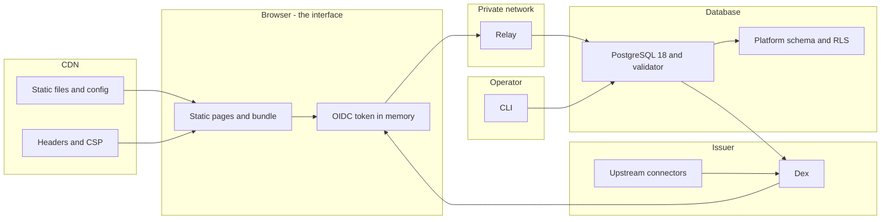

# Platform 2.3.0 — Threat Model

Repo: `/var/home/isaac/Documents/projects/platform` (branch `main`, commit `d3429cb`)
Scope: the runtime platform — `packages/relay`, `packages/pg-client`, `packages/ui`, `packages/cli`, `packages/data`, `packages/vocabulary`, `migrations/`, `deploy/`.

---

## Executive summary

Platform has no application server: the browser speaks PostgreSQL's wire protocol directly through a byte-forwarding relay, and PostgreSQL 18 plus Dex are the only identity and authorization authorities. The dominant risk is therefore not application logic but **the identity chain that feeds PostgreSQL**: the role a session gets is the role named by an unverified-at-the-edge, email-shaped claim that an upstream connector asserts, and the validator checks no audience (TM-001, TM-003). The second theme is **the transport the docs themselves call out as untrusted**: bearer tokens travel in cleartext between relay and database, are held only in JS memory, and cannot be revoked before expiry (TM-002). The third is **availability of the shared database and the relay**: the relay opens a PostgreSQL backend for every WebSocket before any credential is presented, has no idle timeout, and ignores write backpressure, while raw SQL lets a reader lift their own `statement_timeout` (TM-004, TM-005). Audit guarantees are weaker than the product language suggests — privilege changes are never audited and the audit table is owned by principals who can suppress it (TM-008). Everything else (SQL construction, column ACLs, forced RLS on metadata) is well constructed and is modeled as an existing control rather than a threat.

---

## Scope and assumptions

### In scope

| Path                                                                                                                     | Why in scope                                                           |
| ------------------------------------------------------------------------------------------------------------------------ | ---------------------------------------------------------------------- |
| `packages/relay/src/relay.ts`                                                                                            | The only component of ours that answers on the network                 |
| `packages/pg-client/src/{wire,socket,kept}.ts`                                                                           | Browser-side PostgreSQL protocol client; carries tokens                |
| `packages/ui/src/**` (esp. `pg/connect.ts`, `session.tsx`, `identity/oidc.ts`, `sql/sql.tsx`, `headers.ts`, `config.ts`) | Browser runtime, sign-in flow, security headers                        |
| `packages/data/src/**`, `packages/vocabulary/src/**`                                                                     | Statement construction and catalog reads                               |
| `packages/cli/src/**` (esp. `apply.ts`, `model.ts`, `harden.ts`, `database/db.ts`, `deployment/**`)                      | Operator tooling; role/grant administration; secret handling           |
| `migrations/0001_platform.sql`                                                                                           | All authorization primitives, `SECURITY DEFINER` helpers, RLS policies |
| `deploy/**` (compose, dex template, postgres image/entrypoint, k8s manifests)                                            | Trust boundaries, `pg_hba` rules, origin policy                        |
| `.github/workflows/check.yml`, `Dockerfile`, `deploy/postgres/Dockerfile`                                                | Build/release supply chain                                             |

### Out of scope (explicit)

- `examples/newsroom/**` and `packages/ui/dist`, `examples/newsroom/.dist` — build output and a demo site whose database is PGlite inside the browser; no production data.
- `packages/*/test/**`, `test/**` — test harnesses and fixtures.
- `.impeccable/**`, `docs/**`, `DESIGN.md`, `PRODUCT.md` — documentation only.
- The upstream Dex connectors themselves, the CDN, the Kubernetes cluster and the ingress controller — third-party infrastructure that Platform only configures.
- PostgreSQL 18 itself and `pg_oidc_validator` (percona) — assessed as trusted components with the caveats noted in TM-003.

### Explicit assumptions

1. **The issuer (Dex) is a single-tenant issuer for Platform.** `docs/security.md` states the validator "does not check the audience, so a token Dex issues to any of its clients is accepted" and instructs operators to "run a Dex for Platform alone". This is assumed to be true in the reviewed deployment. If the issuer is shared with other applications, TM-003 severity rises.
2. **Upstream connectors are trusted to assert only addresses the operator controls.** The role name is the token's email claim (`deploy/postgres/entrypoint.sh`, `pg_oidc_validator.authn_field=$claim`). A connector that allows self-registration or unverified email makes TM-001 immediately exploitable.
3. **The relay and PostgreSQL share a trusted private network.** The relay speaks plain TCP to PostgreSQL (`packages/relay/src/relay.ts` `open()` → `connect()`; `docs/security.md` "The relay connects to PostgreSQL in plain TCP"). Assumed to be the same host/pod network as in `deploy/compose/compose.yaml`.
4. **The interface is served over HTTPS from a CDN that honours `_headers`.** The CSP, HSTS and `X-Frame-Options` are only as strong as the CDN's adherence to `packages/ui/dist/_headers` (generated by `packages/ui/src/headers.ts`).
5. **Any role with `LOGIN` is treated as an authenticated user of the platform**, and `platform_users` membership is the "may connect" boundary (`migrations/0001_platform.sql`).
6. **The operator (cluster superuser / `platform_core` member) is trusted.** The platform's model explicitly states object owners, `BYPASSRLS` roles and superusers are trusted administrators.
7. **Data sensitivity is moderate**: newsroom/CRM-style business records (drafts, corrections, accounts, contacts, deals) — PII and business-confidential, not payment-card or health data. This drives TM-009 (audit capture of hidden columns) down from high to medium.
8. **Scale**: a single-fleet, single-tenant installation at modest scale (tens of concurrent readers), deployed as 2 relay replicas in the reference Kubernetes manifest (`deploy/k8s/deployment.yaml`).

### Open questions that would materially change ranking

- **Q1 — Are the Dex connectors allowed to self-register, and is email verification enforced per connector?** (`deploy/dex/config.yaml.tmpl` only documents `insecureSkipEmailVerified: false` for OIDC connectors.) Answering "yes, self-service" turns TM-001 from _high_ to _critical_ and makes it remotely exploitable without any credentials.
- **Q2 — Is `PLATFORM_TOKEN_ONLY_FROM` set in the production deployment, and is the PostgreSQL port reachable from anywhere other than the relay network?** (`deploy/postgres/entrypoint.sh`, `deploy/compose/compose.yaml`.) Answering "not set / publicly reachable" elevates TM-011.
- **Q3 — Is the CDN's `config.json` (the runtime pointer to the issuer and relay) integrity-protected, and does the CDN apply `_headers`?** Answering "no integrity protection" elevates TM-006.

---

## System model

### Primary components

| Component                                     | Role                                                                                                                                                                                                          | Evidence                                                                                         |
| --------------------------------------------- | ------------------------------------------------------------------------------------------------------------------------------------------------------------------------------------------------------------- | ------------------------------------------------------------------------------------------------ |
| **Static interface (browser)**                | Prerendered pages + one JS bundle. Speaks PostgreSQL v3 wire protocol from the browser; holds the OIDC token in JS memory only; runs the reader's SQL as the reader's own login                               | `packages/ui/src/pg/connect.ts`, `packages/ui/src/session.tsx`, `packages/pg-client/src/wire.ts` |
| **Relay**                                     | WebSocket→TCP forwarder in front of PostgreSQL. Enforces Origin allowlist, per-address and per-role session caps, reads `session_authorization` from the server stream to count by role. Holds no credentials | `packages/relay/src/relay.ts`                                                                    |
| **PostgreSQL 18 + `pg_oidc_validator`**       | The identity and authorization authority: verifies the token (signature, issuer, expiry) at startup, logs in the role named by the email claim; enforces ACLs, column grants, RLS                             | `deploy/postgres/Dockerfile`, `deploy/postgres/entrypoint.sh`, `migrations/0001_platform.sql`    |
| **Dex (issuer)**                              | OIDC issuer; fronts upstream connectors; issues the 1-hour token                                                                                                                                              | `deploy/dex/config.yaml.tmpl`, `packages/ui/src/identity/oidc.ts`                                |
| **Platform schema (`platform`)**              | Helper functions (`record_change` is the only `SECURITY DEFINER` writer), `platform.activity` audit table with RLS, installation marker                                                                       | `migrations/0001_platform.sql`                                                                   |
| **Operator CLI**                              | `migrate`, `apply` (manifests → roles/grants/policies), `model:apply`, `harden`, `sql`, `doctor`, `token`, `deploy`. Connects with a token or the administrator's password                                    | `packages/cli/src/cli.ts`                                                                        |
| **Workspace metadata (`<ws>.item_metadata`)** | Per-workspace metadata collection under _forced_ RLS                                                                                                                                                          | `migrations/0001_platform.sql` (`create_metadata`)                                               |
| **CDN**                                       | Publishes the static site, `config.json`, `_headers`                                                                                                                                                          | `packages/cli/src/ui/build.ts`, `packages/ui/src/headers.ts`                                     |

### Data flows and trust boundaries

- **Browser → Relay (WebSocket, WSS in production)** — carries the reader's OIDC bearer token (inside the OAUTHBEARER SASL message), SQL statements and bound parameters, and result rows. _Guarantees:_ TLS (deployment responsibility), Origin allowlist (`originAllowed`, `packages/relay/src/relay.ts`), session caps. _Validation:_ none of the bytes — PostgreSQL validates the token and the SQL. The relay reads only `ParameterStatus`/`session_authorization`; it never inspects the SASL payload.
- **Relay → PostgreSQL (plain TCP)** — the same bytes, including the bearer token, in cleartext. _Guarantees:_ none beyond network trust. `docs/security.md` states the browser cannot negotiate PostgreSQL TLS inside the stream, so `DATABASE_SSL` does not apply here. _Validation:_ PostgreSQL's `pg_hba` + `pg_oidc_validator`.
- **Browser → Dex (HTTPS)** — authorization code + PKCE, no client secret; PKCE verifier in `sessionStorage`, removed on return; token kept in memory only. _Guarantees:_ PKCE, `state` check, issuer's own checks.
- **PostgreSQL → Dex (HTTPS, JWKS/discovery)** — trust anchor for token signatures. _Guarantees:_ `pg_oidc_validator` checks signature, issuer, expiry — **not audience**.
- **Upstream connector → Dex** — asserts the email claim that becomes the **PostgreSQL role name**. This is the highest-consequence trust edge in the system.
- **CDN → Browser** — `config.json` names the issuer and the relay at runtime; `_headers` carries CSP/HSTS. _Guarantees:_ integrity of the bundle is assumed (no SRI); the CSP blocks third-party script/style/connect targets.
- **CLI → PostgreSQL (TLS)** — administrator password or bearer token via `pg`/`TokenClient`; `DATABASE_SSL=require` with `rejectUnauthorized` and optional CA file (`packages/cli/src/database/db.ts`). _Validation:_ manifest input is schema-validated with zod; identifiers are quoted (`ident`) and values bound or escaped (`literal`).
- **Operator → CLI (env/files)** — `PGTOKEN[_FILE]`, `PGUSER`/`PGPASSWORD[_FILE]`, `POSTGRES_PASSWORD[_FILE]`; local stack writes generated passwords into `.env` (`packages/cli/src/deployment/local.ts`).

#### Diagram

### Runtime vs build/CI separation

- **Runtime**: browser bundle, relay container, PostgreSQL + validator, Dex, CDN-served files. Everything in the diagram above.
- **Operator runtime**: the CLI (`packages/cli`), which holds the administrator password or a token and is never deployed as a service (`Dockerfile` target `cli`; `deploy/compose/compose.yaml` `migrate` service sits behind the `install` profile and is not part of `up`).
- **Build/CI only**: `Dockerfile` targets `build-ui`, `dependencies`, `cli`, `relay`; `deploy/postgres/Dockerfile` compiles `pg_oidc_validator` from a pinned, sha256-verified release; `.github/workflows/check.yml` builds the image and runs the test suite. CI holds `test-admin-password` and an in-process issuer — test-only credentials, not deployed.
- **Not runtime**: `packages/ui/dist`, `examples/newsroom/.dist`, `packages/*/test`, `test/`.

---

## Assets and security objectives

| Asset                                                              | Why it matters                                                                                             | Security objective |
| ------------------------------------------------------------------ | ---------------------------------------------------------------------------------------------------------- | ------------------ |
| OIDC bearer tokens (in memory, on the wire, in relay→PG cleartext) | A token _is_ the login: whoever holds one is that role until expiry, with no revocation list               | C                  |
| PostgreSQL role/identity graph (`pg_auth_members`, `pg_roles`)     | Determines who can reach what; `harden` exists specifically to hide it                                     | C, I               |
| Workspace data (newsroom, CRM records)                             | Business records and PII of staff/customers                                                                | C, I               |
| Private columns hidden by column ACLs                              | Explicitly designed to be unreadable (`internal_notes` example in README)                                  | C                  |
| `platform.activity` audit trail (before/after row JSONB)           | Forensics, revision history, integrity of the record                                                       | I, C               |
| The administrator login (the only password)                        | Installation and Dex-outage recovery; full superuser capability                                            | C, I               |
| Grants, row policies, group memberships                            | The authorization model itself                                                                             | I                  |
| The static bundle + `config.json`                                  | The bundle runs in every reader's browser; `config.json` names the issuer and relay the token is handed to | I                  |
| Relay availability and PostgreSQL connection pool                  | Every reader's session depends on it                                                                       | A                  |
| The `platform` schema functions (`record_change` and friends)      | Only elevated code path; `SECURITY DEFINER` owner is `platform_core`                                       | I                  |
| Build artifacts (relay/cli images, the CDN site)                   | Supply chain to every reader                                                                               | I                  |

---

## Attacker model

### Capabilities

- **Remote unauthenticated attacker** on the internet: can open WebSockets to the relay, spoof the `Origin` header from a non-browser client (the relay checks only that header — `originAllowed` reads `request.headers.get('origin')`), flood the relay, and attempt token logins with forged/expired/foreign tokens (all of which PostgreSQL rejects).
- **Authenticated low-privilege reader** (any `platform_users` member with a role): holds a valid token, can run arbitrary SQL as themselves, can create tables in schemas where they hold `CREATE`, and can read/write the SQL page's results.
- **Authenticated workspace owner / `CREATEROLE` administrator**: can create roles, grant memberships (where they hold admin option), create and alter policies, read their workspace's full revision history including columns hidden by column grants, and disable triggers on tables they own.
- **Token holder of a stolen/leaked token** (e.g. obtained by XSS in the bundle, by a hostile CDN, or by a MITM between relay and PostgreSQL): acts as that role for the token's remaining lifetime.
- **Malicious or careless upstream connector**: can assert any email claim, and therefore log in as any role including the administrator.

### Non-capabilities

- **No remote application-server exploitation**: there is no server-side request handler, no session store, no deserializer, no template engine, no file upload, and no server-side SQL construction to exploit. Injection through the UI's own statements is not available: identifiers are quoted (`packages/vocabulary/src/core.ts` `ident`), values are bound (`packages/data/src/content/query.ts`), and literals are escaped (`literal`).
- **No privilege escalation through the transport**: the relay and the page are not policy authorities; a buggy statement built by the page cannot make PostgreSQL grant rights (`docs/security.md`).
- **No escalation from a token to another role through the interface**: the page reads the role name from the claim but PostgreSQL verifies the token and the claim match; a forged claim dies at the login.
- **No direct PostgreSQL network access** for an ordinary reader: the only network path is the relay, and `PLATFORM_TOKEN_ONLY_FROM` is intended to make the relay's network token-only (`deploy/postgres/entrypoint.sh`).
- **No SQL sandbox**: readers may run any SQL they are authorized to run. This is by design, and it is _not_ a vulnerability, but it removes a mitigation that some readers assume exists (`docs/security.md`, "There is no SQL sandbox or allowlist").
- **Superusers, `BYPASSRLS` roles and object owners are out of scope as attackers** — they are trusted administrators by the platform's own model.

---

## Entry points and attack surfaces

| Surface                            | How reached                            | Trust boundary           | Notes                                                                                                             | Evidence                                                                             |
| ---------------------------------- | -------------------------------------- | ------------------------ | ----------------------------------------------------------------------------------------------------------------- | ------------------------------------------------------------------------------------ |
| Relay WebSocket `/` (any path)     | Any HTTP client with an Upgrade header | Internet → relay         | Origin header is client-controlled; upstream TCP opened before login; no idle timeout; write backpressure ignored | `packages/relay/src/relay.ts` `fetch()`, `websocket.open()`                          |
| Relay `/health`                    | GET                                    | Internet → relay         | Unauthenticated, unauthenticated-liveness info only                                                               | `relay.ts` `if (url.pathname === '/health')`                                         |
| `Origin` header                    | Handshake                              | Browser → relay          | The only cross-site control; `RELAY_ORIGINS` empty ⇒ any origin allowed                                           | `relay.ts` `originAllowed()`, `relayOptionsFromEnv()`                                |
| OIDC authorization endpoint        | Browser redirect                       | Browser → Dex            | `state` + PKCE; `redirect_uri` fixed to `location.origin/`                                                        | `packages/ui/src/identity/oidc.ts` `beginSignIn`                                     |
| OIDC token endpoint                | Browser POST                           | Browser → Dex            | PKCE verifier from `sessionStorage`; no client secret (public client)                                             | `packages/ui/src/identity/oidc.ts` `completeSignIn`                                  |
| PostgreSQL login (OAUTHBEARER)     | Page → relay → PG                      | Relay → PostgreSQL       | Token in cleartext on this hop; validator checks signature/issuer/expiry only                                     | `packages/pg-client/src/wire.ts` `authentication()`, `deploy/postgres/entrypoint.sh` |
| `pg_hba.conf` rules                | Network connection                     | Network → PostgreSQL     | `local all all trust`; admin scram rule; `oauth` rule; optional token-only CIDRs                                  | `deploy/postgres/entrypoint.sh`                                                      |
| `config.json`                      | Fetched by the page at runtime         | CDN → browser            | Names issuer and relay; a modified copy redirects the token                                                       | `packages/ui/src/config.ts` `runtimeConfig()`                                        |
| Bundle `app.js` + prerendered HTML | Served by CDN                          | CDN → browser            | XSS here reads the in-memory token; CSP is the mitigation                                                         | `packages/ui/src/pg/connect.ts`, `packages/ui/src/headers.ts`                        |
| SQL page                           | Any signed-in reader                   | Reader → PostgreSQL      | Arbitrary SQL as the reader's own role; reader may `SET statement_timeout`                                        | `packages/ui/src/sql/sql.tsx`, `packages/ui/src/session.tsx` `withReaderDb`          |
| Access/roles pages                 | Operator in the browser                | Browser → PostgreSQL     | `CREATE ROLE`, `GRANT`, `CREATE POLICY` executed as the reader; PostgreSQL requires CREATEROLE/ownership          | `packages/ui/src/access/access.tsx`, `packages/vocabulary/src/dcl.ts`                |
| CLI `apply` / `model:apply`        | Operator, JSON manifest file           | Operator → PostgreSQL    | zod-validated; quoted identifiers; manifest policy expressions are raw SQL text                                   | `packages/cli/src/apply.ts`, `packages/cli/src/model.ts`                             |
| CLI `sql FILE`                     | Operator                               | Operator → PostgreSQL    | Executes an arbitrary file with the caller's rights                                                               | `packages/cli/src/cli.ts`                                                            |
| CLI `harden`                       | Cluster superuser                      | Operator → PostgreSQL    | Revokes public read of `pg_auth_members`, `pg_roles`, `pg_user`                                                   | `packages/cli/src/harden.ts`                                                         |
| CLI `token`                        | Operator                               | CLI → Dex                | Device flow; prints a bearer token to stdout                                                                      | `packages/cli/src/token.ts`                                                          |
| `deploy local`                     | Operator, `.env`                       | Operator → Docker/Podman | Generates and stores admin + three example passwords in `.env`; local Dex over plain HTTP                         | `packages/cli/src/deployment/local.ts`, `deploy/dex/config.yaml.tmpl`                |
| Docker images / CI                 | `docker build`, GitHub Actions         | Build → registry/CDN     | Validator built from a sha256-pinned release; Actions pinned by tag, not SHA                                      | `deploy/postgres/Dockerfile`, `.github/workflows/check.yml`                          |

---

## Top abuse paths

1. **Take over the administrator through the connector.** An upstream provider (or a self-registration flow Dex fronts) accepts `admin@example.com` as a user's address → Dex issues a token whose `email` claim is `admin@example.com` → `pg_oidc_validator` logs that session in as the PostgreSQL role `admin@example.com` → the attacker holds CREATEROLE, the role catalogs, and every workspace's rights. _No credential, no exploit, only a configuration._
2. **Steal a token from the wire and replay it.** Attacker with a foothold on the relay↔PostgreSQL path (or on the browser origin) reads the OAUTHBEARER SASL message from the cleartext TCP stream → replays the token to the relay from their own host → PostgreSQL accepts the token and logs the attacker in as the victim for the remaining lifetime of the token; no revocation list exists, and the interface's "sign out" only discards the local copy.
3. **Exhaust the database with unauthenticated sockets.** Attacker opens many WebSockets to the relay (scripted clients can set any `Origin`), each of which immediately opens a PostgreSQL backend before any credential is presented; the client never completes the login, so the per-address cap counts it as "logging in" but the sockets stay open indefinitely (no idle timeout) → PostgreSQL's `max_connections` is consumed → every legitimate reader, including the operator's psql session, is refused.
4. **Point the pages at a relay of the attacker's choosing.** Attacker with write access to the CDN's `config.json` sets `relay` to `wss://attacker.example` → the page opens a WebSocket there and sends the reader's OIDC token inside the PostgreSQL login → the attacker replays it. The CSP `connect-src` is a mitigation only if the CDN honours `_headers` _and_ the build-time relay origin matches.
5. **Hold the database hostage with a single signed-in reader.** Reader signs in normally, opens the SQL page, and runs `SET statement_timeout = 0; SELECT ...` over a large table (or opens a long transaction) → the statement runs without a timeout, holding a backend and I/O for as long as the attacker wants; `statement_timeout` was set at login but is a session setting the reader controls.
6. **Learn what a workspace owner cannot see.** Reader writes a row whose private column holds a secret → the `platform_audit` trigger records the whole row, including the column hidden by a column-level GRANT, in `platform.activity` → a workspace owner (or any member with the owner's rights) reads the full revision history and sees the hidden value.
7. **Read the role graph that `harden` was meant to hide.** Where `harden` has not been run (or was run `--keep-names`), any connected session reads `pg_auth_members`/`pg_roles` and maps who administers what, which is reconnaissance for path 1.
8. **Make privilege escalation invisible.** An operator with CREATEROLE grants itself `platform_users` admin option and creates a new privileged role; `platform.activity` records only row DML through the audit triggers — no `GRANT`, no `CREATE ROLE`, no authentication events — so the audit trail shows nothing, and the trigger itself is owned by principals who can disable it.

---

## Threat model table

| Threat ID | Threat source                                                         | Prerequisites                                                                                                           | Threat action                                                                                                                                                                                                                                                                                          | Impact                                                                                                                                                                 | Impacted assets                                      | Existing controls (evidence)                                                                                                                                                                                                                                                                                                 | Gaps                                                                                                                                                                                                                                                                                                                                                                                                                                                                                                                                                           | Recommended mitigations                                                                                                                                                                                                                                                                                                                                                                                                                                                                       | Detection ideas                                                                                                                                                                                                               | Likelihood                                                                           | Impact severity | Priority     |
| --------- | --------------------------------------------------------------------- | ----------------------------------------------------------------------------------------------------------------------- | ------------------------------------------------------------------------------------------------------------------------------------------------------------------------------------------------------------------------------------------------------------------------------------------------------ | ---------------------------------------------------------------------------------------------------------------------------------------------------------------------- | ---------------------------------------------------- | ---------------------------------------------------------------------------------------------------------------------------------------------------------------------------------------------------------------------------------------------------------------------------------------------------------------------------- | -------------------------------------------------------------------------------------------------------------------------------------------------------------------------------------------------------------------------------------------------------------------------------------------------------------------------------------------------------------------------------------------------------------------------------------------------------------------------------------------------------------------------------------------------------------- | --------------------------------------------------------------------------------------------------------------------------------------------------------------------------------------------------------------------------------------------------------------------------------------------------------------------------------------------------------------------------------------------------------------------------------------------------------------------------------------------- | ----------------------------------------------------------------------------------------------------------------------------------------------------------------------------------------------------------------------------- | ------------------------------------------------------------------------------------ | --------------- | ------------ |
| TM-001    | Malicious or permissive upstream identity provider                    | A Dex connector that can assert an arbitrary/unverified email address, and a role with that name existing in PostgreSQL | Forge the `email` claim; PostgreSQL logs the session in as that role                                                                                                                                                                                                                                   | Full impersonation of any role, including administrators; no credential required                                                                                       | Roles, workspace data, audit trail, admin capability | Email claim must equal an existing role name (`deploy/postgres/entrypoint.sh`, `pg_oidc_validator.authn_field`); operators can restrict which connectors exist (`docs/security.md`); role names are known to the attacker only if the role graph is exposed                                                                  | Nothing in Platform prevents a connector from asserting an existing address; no per-connector allowlist; role names are guessable (email format)                                                                                                                                                                                                                                                                                                                                                                                                               | (a) Give every connector its own issuer or use a distinct claim per connector, and map claim→role via a table rather than the raw email; (b) require per-connector `insecureSkipEmailVerified: false` and document it as a deployment gate; (c) keep `admin`/operator roles out of the email-shaped namespace (e.g. prefix service roles) so a public address cannot collide; (d) monitor `pg_log` for `authentication` events and alert on logins to reserved roles from unexpected issuers  | PostgreSQL log of successful/failed authentications; alert on any session for a role matching `*@*` that is a member of `platform_admins`/`platform_core`; periodic reconciliation of role names against the HR/IdP directory | medium (configuration-dependent; certain if any connector permits self-registration) | high            | **critical** |
| TM-002    | Network/host/CDN/browser compromise                                   | Attacker can observe relay↔PostgreSQL TCP traffic, the CDN origin, or execute script in the page                        | Capture the OAUTHBEARER token and replay it                                                                                                                                                                                                                                                            | Impersonation of the victim role for the token's remaining lifetime (1h default, `deploy/dex/config.yaml.tmpl`); no revocation                                         | Bearer tokens, workspace data                        | Tokens validated by PostgreSQL at every login; the relay holds no credentials; token never persisted to storage, only JS memory (`packages/ui/src/session.tsx`); CSP and no third-party script (`packages/ui/src/headers.ts`)                                                                                                | Relay→PostgreSQL is cleartext by design (`docs/security.md`); no token revocation list; no session binding to the relay/browser; the page cannot zero JS strings                                                                                                                                                                                                                                                                                                                                                                                               | (a) Put the relay and PostgreSQL on a private network or a mTLS mesh; (b) shorten `DEX_TOKEN_LIFETIME` and treat any token as a one-hour credential in incident response; (c) if mTLS to PostgreSQL is ever possible, terminate TLS inside the relay and tunnel; (d) consider a relay-side check that the token is presented only once per session (no reuse)                                                                                                                                 | Alert on the same token authenticating from two source addresses; log (not content) authentication outcomes; alert on relay sessions that never present a token                                                               | medium                                                                               | high            | **high**     |
| TM-003    | Any holder of a token minted by the same issuer for another client    | The issuer hosts more than one client (e.g. `platform-psql` and `platform-console`)                                     | Replay a token issued to client A at client B; the validator checks no audience                                                                                                                                                                                                                        | Cross-client token confusion; a token intended for a lower-trust surface is accepted at the database; a token minted for a client with a broader scope may be accepted | Bearer tokens, session integrity                     | Validator checks signature, issuer and expiry; documented limitation with the mitigation "run a Dex for Platform alone" (`docs/security.md`)                                                                                                                                                                                 | No audience validation in `pg_oidc_validator`; nothing in Platform pins the token audience                                                                                                                                                                                                                                                                                                                                                                                                                                                                     | Run a dedicated issuer for Platform with no other clients; if the validator supports an audience check, enable it; treat any additional client registered on the issuer as a scope expansion                                                                                                                                                                                                                                                                                                  | Inventory the issuer's registered clients in the runbook; alert on tokens whose `aud` is not `platform-console`/`platform-psql` by decoding (not verifying) at the relay for telemetry only                                   | low                                                                                  | medium          | **medium**   |
| TM-004    | Unauthenticated remote attacker                                       | The relay is reachable (it is the only public component) and PostgreSQL's `max_connections` is finite                   | Open many WebSockets; each opens a PostgreSQL backend at `websocket.open()` before any credential is presented; never complete the login; never close                                                                                                                                                  | Exhaustion of PostgreSQL connections → total denial of service for all readers and the operator; relay memory growth via unthrottled `socket.write` backpressure       | Relay availability, PostgreSQL availability          | Per-address cap on _logging-in_ sessions (`RELAY_SESSIONS_PER_ADDRESS`, default 20) and per-role cap after sign-in (`RELAY_SESSIONS_PER_ROLE`, default 20); `cap_drop: [ALL]`, `read_only`, `no-new-privileges` (`deploy/compose/compose.yaml`)                                                                              | The upstream socket is opened before authentication and there is no idle timeout, so unauthenticated sockets are held indefinitely; the origin check is a browser-only control and is trivially forged by a scripted client; `socket.write` return value is ignored, so a fast client can buffer unbounded data in the relay; the per-address cap counts only sessions still logging in; with 2 k8s replicas the effective cap is per-pod; `requestIP` behind an ingress may collapse all clients to one address (cap either ineffective or globally blocking) | (a) Idle-timeout unauthenticated relay sessions (e.g. 30–60 s to complete login) and close them; (b) limit upstream bytes per session and honour `write()` backpressure; (c) make the per-address cap count _all_ open sessions, and derive the client address from a trusted forwarded header only behind a known proxy; (d) enforce the cap cluster-wide (shared store) or document it as per-pod; (e) cap concurrent unauthenticated upstream connections at the network layer (conntrack) | Alert on relay→PostgreSQL connection count vs `max_connections`; alert on sessions that never authenticate; alert on relay memory growth and on `429` rate spikes by source address                                           | medium                                                                               | high            | **high**     |
| TM-005    | Any authenticated reader                                              | A valid token for any `platform_users` role                                                                             | Run expensive or long-running SQL on the SQL page's dedicated login; `SET statement_timeout = 0` overrides the 15 s set at login; `idle_in_transaction_session_timeout` likewise                                                                                                                       | CPU/IO exhaustion of the shared database, connection pinning, degraded availability for all workspaces                                                                 | PostgreSQL availability                              | `statement_timeout` (15 s) and `idle_in_transaction_session_timeout` (15 s) are set at login (`packages/ui/src/pg/connect.ts`); the reader's raw SQL uses a **separate** login from the platform's own work (`packages/ui/src/session.tsx` `withReaderDb`), so it cannot pin the platform's connection; per-role session cap | The timeouts are ordinary session settings the reader may change; there is no sandbox or allowlist (documented); `max_connections` is the only global ceiling                                                                                                                                                                                                                                                                                                                                                                                                  | Enforce timeouts server-side per role/database (e.g. `ALTER ROLE ... SET statement_timeout`, `ALTER DATABASE ... SET`), because the login-time value is advisory; cap `work_mem`/`temp_file_limit` per role; consider `pg_stat_statements` baselining for the top offenders                                                                                                                                                                                                                   | `pg_stat_statements` top-total-time report; alert on connections in `idle in transaction` and on `statement_timeout = 0` sessions; track per-role total runtime                                                               | high                                                                                 | medium          | **high**     |
| TM-006    | CDN compromise or a careless deployment edit                          | Write access to `config.json` on the CDN, or a build that ships the wrong file                                          | Change `relay`/`issuer` in `config.json`; the page then hands the OIDC token to the attacker's WebSocket endpoint                                                                                                                                                                                      | Silent theft of every reader's token; complete compromise of all readers who load the page                                                                             | Bearer tokens, all user data                         | `config.json` is fetched same-origin with `cache: no-store` (`packages/ui/src/config.ts`); CSP `connect-src` restricts to the build-time origins (`packages/ui/src/headers.ts`)                                                                                                                                              | No integrity protection (hash, signature, or immutable deployment) on `config.json`; the CSP only helps if the CDN applies `_headers` _and_ the build-time origins match; no runtime validation that the runtime relay equals the built origin                                                                                                                                                                                                                                                                                                                 | Publish `config.json` as part of an immutable, digest-verified deployment (or embed the issuer/relay in the bundle and drop the runtime file); add a release-time check that the runtime config matches the CSP origins; make the CDN's `_headers` support a deployment gate                                                                                                                                                                                                                  | Monitor CDN change events on `config.json` and `app.js`; alert on any content change to those two paths; hash-pin the bundle in CI and verify it after deploy                                                                 | low                                                                                  | high            | **medium**   |
| TM-007    | Supply-chain compromise of the static bundle or of a build dependency | Compromise of the CDN upload path, the registry, or a transitive npm dependency pulled by `bun install`                 | Ship a modified `app.js` that exfiltrates the in-memory token                                                                                                                                                                                                                                          | Every reader's token stolen at next page load; effectively universal compromise                                                                                        | Bearer tokens, all user data                         | `bun install --frozen-lockfile` with a committed `bun.lock`; the validator is built from a sha256-pinned release (`deploy/postgres/Dockerfile`); CSP forbids third-party scripts and inline script; `nosniff`; prerendered pages contain no runtime state                                                                    | Actions pinned by mutable tag (`actions/checkout@v4`, `oven-sh/setup-bun@v2`) rather than SHA; no artifact signing or provenance attestation for the CDN upload; CSP strength depends entirely on the CDN applying `_headers`; `dist/` artefacts are committed in-tree for the example, which invites accidental publication                                                                                                                                                                                                                                   | Pin Actions to commit SHAs; publish the bundle with a signed digest and verify it in the deploy pipeline; add a build step that fails if `app.js` contains anything but the expected bundle hash; make CDN header application a deployment acceptance test                                                                                                                                                                                                                                    | Alert on any change to `app.js`/`config.json` in the CDN; SBOM + dependency review; periodic rebuild reproducibility check                                                                                                    | low                                                                                  | high            | **medium**   |
| TM-008    | Operator with `CREATEROLE`, or a workspace owner                      | `CREATEROLE` (granted by `apply` for `admin: true` users, `packages/cli/src/apply.ts`) or ownership of a collection     | Escalate silently: grant themselves admin option on `platform_users`, create a privileged role, alter or disable triggers on owned tables                                                                                                                                                              | Privilege escalation that the audit trail does not reveal; audit suppression                                                                                           | Audit trail, grants and policies, role graph         | `platform.activity` records DML through triggers; `record_change` is the only `SECURITY DEFINER` writer, owned by `platform_core`, append-only for ordinary roles (`docs/security.md`); `harden` hides the role graph                                                                                                        | `GRANT`, `CREATE ROLE`, `ALTER ROLE`, `CREATE POLICY`, `ALTER TABLE ... DISABLE TRIGGER`, authentication events and failed attempts are **not** audited at all; `platform.activity` is owned by principals who may alter it; `TRUNCATE` is logged but the row contents are lost; no superuser event trigger                                                                                                                                                                                                                                                    | Enable `pgaudit` (or `log_statement` for DCL) for `GRANT`/`REVOKE`/`CREATE ROLE`/`ALTER ROLE`; ship logs to an append-only external destination; document that the platform audit is not tamper-evident and pair it with PostgreSQL-native logging; add `ALTER TABLE ... DISABLE TRIGGER` to the alert set                                                                                                                                                                                    | Ship `pg_hba`/PostgreSQL logs off-box and alert on DCL and role changes; alert on `ALTER TABLE ... DISABLE TRIGGER`; nightly comparison of `pg_auth_members` against a signed snapshot                                        | medium                                                                               | medium          | **medium**   |
| TM-009    | A reader with write access to a collection                            | A collection has a column hidden by a column-level GRANT, or a value the reader considers sensitive                     | Write a value into the hidden column; the `platform_audit` trigger stores the entire `OLD`/`NEW` row as JSONB in `platform.activity`                                                                                                                                                                   | A workspace owner (or the owner's group) reads the value the column grant was meant to protect, via the revision history                                               | Private column values, audit trail                   | Audit policy limits full revisions to workspace owners (`owner_reads` policy, `migrations/0001_platform.sql`); the platform explicitly notes that letting actors read their own entries would leak hidden columns                                                                                                            | The trigger captures _all_ columns regardless of column grants; column-level confidentiality is not preserved in the audit trail                                                                                                                                                                                                                                                                                                                                                                                                                               | Redact or exclude columns marked confidential from the audit trigger (e.g. a per-column `private` flag honoured by `record_change`); restrict `platform.activity` reads further (per-workspace, opt-in); document the leak explicitly in the security docs                                                                                                                                                                                                                                    | Alert on audit reads by roles that hold no read privilege on the audited columns                                                                                                                                              | medium                                                                               | low             | **medium**   |
| TM-010    | Anyone with filesystem access to the operator's checkout or CI logs   | The operator ran `deploy local up` on a workstation                                                                     | Read `.env` (plaintext `POSTGRES_PASSWORD`, `PLATFORM_ADMIN_PASSWORD`, `ALICE_PASSWORD`, `BOB_PASSWORD`) or the local Dex password DB over plain HTTP                                                                                                                                                  | Administrative password compromise on the local stack; the local Dex accepts any of the three example people without a real IdP                                        | Administrator credential, example identities         | `.env` is gitignored and excluded by `.dockerignore`; the Compose file passes only password _hashes_ to Dex (`deploy/compose/compose.yaml`); the local stack binds PostgreSQL and Dex to `127.0.0.1`; the CLI writes secrets with `0600` (`packages/cli/src/deployment/runtime.ts`)                                          | The local stack's issuer is plain HTTP and the local Dex accepts the example passwords; the three example roles are also created by `--example` in the _real_ database if the operator follows the README literally                                                                                                                                                                                                                                                                                                                                            | Keep the local stack on loopback only (already the case) and treat it as non-production; prefer `_FILE`-based secret injection for any shared environment; add a README warning that `deploy local up` creates a live administrator password and the `--example` manifest creates real login roles                                                                                                                                                                                            | Scan for the known generated password pattern in repositories; periodic rotation of the local administrator password                                                                                                          | low                                                                                  | medium          | **low**      |
| TM-011    | Misconfiguration of the operator                                      | `PLATFORM_TOKEN_ONLY_FROM` unset, or the PostgreSQL port exposed beyond the relay network                               | Connect directly to PostgreSQL and try passwords or tokens from outside the intended path                                                                                                                                                                                                              | Direct database access bypassing the relay's Origin and session caps; brute-force surface for the administrator password                                               | Administrator credential, database availability      | `pg_hba` restricts password auth to the named administrator and all other logins to `oauth` (`deploy/postgres/entrypoint.sh`); `doctor` checks that no rule admits a login without a token (`packages/cli/src/database/requirements.ts`); the local compose sets `PLATFORM_TOKEN_ONLY_FROM=10.89.71.0/24`                    | The token-only CIDR list is optional and environment-dependent; `local all all trust` trusts the container's unix socket; the admin password is accepted from _any_ address unless the token-only list is set; `doctor` needs superuser rights to check `pg_hba_file_rules` and returns `unchecked` otherwise                                                                                                                                                                                                                                                  | Make `PLATFORM_TOKEN_ONLY_FROM` mandatory in production templates; run `doctor` (as superuser) as a deployment gate and fail the deploy if it reports `unchecked`; set `PLATFORM_HBA_HOST=hostssl` where TLS is configured; keep the PostgreSQL port unpublished except to the relay network; reduce `local ... trust` to the `postgres` user where feasible                                                                                                                                  | Alert on `doctor` output of `unchecked`; review `pg_hba_file_rules` on change; alert on failed password authentication attempts                                                                                               | low                                                                                  | high            | **medium**   |
| TM-012    | A reader or a hostile client                                          | The relay's counters are per-process and per-address                                                                    | Drive the caps incorrectly: the address counter is restored to a stale value on a failed upgrade (`loggingIn.set(address, count)`), so concurrent failures can undercount; the per-role cap is keyed on the _initial_ `session_authorization` and does not follow a later `SET ROLE`; caps are per pod | Session caps weaker than documented, or (the opposite failure) all legitimate users behind one ingress address sharing a single 20-session bucket and being refused    | Relay availability                                   | Caps implemented in `signedIn`/`readRole` (`packages/relay/src/relay.ts`); role counted only after PostgreSQL reports the role, so a client cannot claim a role it was not signed in as                                                                                                                                      | Restore-by-write race on the address counter; per-pod counters with 2 replicas; `requestIP` semantics behind a proxy; the role key does not track `SET ROLE`                                                                                                                                                                                                                                                                                                                                                                                                   | Use an atomic decrement on close; count sessions per _connection_ and per role in a shared store (or document per-pod); derive the client address from the ingress's forwarded header with an explicit trusted-proxy list; re-read the role on `SET ROLE` (`ParameterStatus` is not re-sent, so a session-level `SET ROLE` should be tracked or forbidden)                                                                                                                                    | Expose relay session counters as metrics (`sessions_by_role`, `sessions_by_address`, `refusals`) and alert on refusals and on counter resets                                                                                  | medium                                                                               | low             | **medium**   |
| TM-013    | A reader with `CREATE` on a schema or ownership of a collection       | `platform_users` membership plus `CREATE` on a schema, or table ownership                                               | Owner-level actions: alter policies, disable the audit trigger, replace a table, read the workspace's full revision history including private columns                                                                                                                                                  | Bypass of the intended row/column policy model; audit suppression for owned tables                                                                                     | Row policies, private columns, audit trail           | RLS is not applied to table owners (documented in `docs/security.md`); metadata tables use `FORCE ROW LEVEL SECURITY`; `platform_core`/`platform_users` are unprivileged `NOLOGIN` groups; `platform.record_change` is fixed-search_path and takes no caller-supplied SQL                                                    | Ownership is a strong authority that the product's own documentation flags; no platform-level detection of a disabled trigger; owners can read history that column grants hide                                                                                                                                                                                                                                                                                                                                                                                 | Require audit triggers to be non-disableable by owners (PostgreSQL cannot fully guarantee this; consider a superuser event trigger to intercept DDL as the docs themselves suggest); restrict `CREATE` on schemas to a dedicated group; make "workspace owner may read hidden columns in history" an explicit, accepted risk in the security docs                                                                                                                                             | Alert on `ALTER TABLE ... DISABLE TRIGGER` and on DDL by non-owners; monitor `pg_stat_user_tables` for sudden drops in revision rows                                                                                          | medium                                                                               | low             | **medium**   |
| TM-014    | A compromised or malicious manifest/policy expression                 | Operator applies a JSON manifest from an untrusted source                                                               | Policy `using`/`check` expressions are raw SQL text inserted into `CREATE POLICY` (`packages/cli/src/apply.ts` `policy()` → `policyStatement`); `GRANT`/`REVOKE` statements are built from quoted identifiers only                                                                                     | A malicious manifest can install an arbitrary policy expression (evaluated as the invoking user) and, if the applier is an administrator, arbitrary rights             | Grants, row policies, workspace data                 | zod schema validation of the manifest; `ident()` quotes identifiers and refuses NUL/over-long names; `literal()` escapes literals; all data values are bound                                                                                                                                                                 | Policy expressions are not validated at all, and `apply` runs with the applier's rights (an administrator in the normal flow)                                                                                                                                                                                                                                                                                                                                                                                                                                  | Validate policy expressions before use (e.g. `EXPLAIN`-style parse check or a restricted grammar for the common `column = value` / `owner_id = session_user` shapes); require manifests to come from a reviewed source; consider a `pg_stat_statements`-free dry-run (`--dry-run` exists) as a mandatory review step                                                                                                                                                                          | Log every applied policy expression and alert on expressions containing function calls or subqueries                                                                                                                          | low                                                                                  | medium          | **low**      |

---

## Criticality calibration

**Critical** — an unauthenticated or trivially reachable path to full administrative control of the database, or to the compromise of every reader's credential, with no platform control mitigating it.

- TM-001: any upstream provider that can assert an administrator's email address.
- A published `config.json`/bundle pointing readers at an attacker-controlled relay (if TM-006's mitigations are not adopted).
- A relay or PostgreSQL host fully controlled by an attacker (all tokens and data lost).

**High** — direct compromise of credentials or of the shared database's availability, where existing controls limit but do not remove the risk.

- TM-002: token capture on the relay↔PostgreSQL hop or in the browser.
- TM-004: unauthenticated connection exhaustion of the shared database.
- TM-005: a single reader disabling `statement_timeout` and pinning database resources.
- A PostgreSQL port reachable from the internet with the administrator's password accepted from anywhere (TM-011 with the token-only list unset).

**Medium** — meaningful but bounded exposure: partial data disclosure, weakened detection, silent-but-recoverable escalation, or misconfiguration that needs one more step.

- TM-003 (token confusion without a shared issuer), TM-006/TM-007 (bundle/config integrity without a second failure), TM-008 (unaudited privilege change), TM-009 (hidden column values in the audit trail), TM-011 (password login reachable from an unintended network), TM-012 (cap accounting defects).

**Low** — limited-sensitivity leakage or noisy conditions with a cheap mitigation.

- TM-010 (local development secrets on an operator's own machine).
- TM-014 (malicious manifest by an already-privileged operator).
- The unauthenticated `/health` endpoint and the disclosure of schema/table names that PostgreSQL publishes by design.

---

## Focus paths for security review

| Path                                                                      | Why it matters                                                                                                               | Related Threat IDs     |
| ------------------------------------------------------------------------- | ---------------------------------------------------------------------------------------------------------------------------- | ---------------------- |
| `deploy/postgres/entrypoint.sh`                                           | Writes the `pg_hba` rules and configures the validator: the network admission boundary and the token-only CIDR logic         | TM-001, TM-003, TM-011 |
| `deploy/dex/config.yaml.tmpl`                                             | Connector list, token lifetime, `skipApprovalScreen`, and the issuer's client registry — the trust upstream of the role name | TM-001, TM-003, TM-010 |
| `packages/relay/src/relay.ts`                                             | The only network-facing component: origin check, session caps, upstream socket lifecycle, backpressure                       | TM-004, TM-002, TM-012 |
| `migrations/0001_platform.sql`                                            | All `SECURITY DEFINER` functions, the `owner_reads` audit policy, `record_change`, forced RLS on metadata, role bootstrap    | TM-008, TM-009, TM-013 |
| `packages/pg-client/src/wire.ts`                                          | The token leaves the browser here; also the OAUTHBEARER refusal path (never sends a password)                                | TM-002, TM-003         |
| `packages/ui/src/identity/oidc.ts`                                        | Authorization code + PKCE flow, `state` check, token selection between `access_token` and `id_token`                         | TM-001, TM-002         |
| `packages/ui/src/session.tsx`                                             | Token lifetime in memory, the two-login split (`withDb` vs `withReaderDb`), sign-out semantics                               | TM-002, TM-005         |
| `packages/ui/src/headers.ts` and `packages/ui/dist/_headers`              | The CSP that limits XSS and cross-origin exfiltration; only as strong as the CDN's adherence                                 | TM-006, TM-007         |
| `packages/ui/src/config.ts` and `packages/cli/src/ui/build.ts`            | Runtime resolution of issuer/relay/database from `config.json` — the pointer the token is handed to                          | TM-006                 |
| `packages/cli/src/apply.ts`                                               | Role creation, `CREATEROLE` grants, `platform_admins` membership, raw policy expressions                                     | TM-008, TM-014, TM-013 |
| `packages/cli/src/harden.ts`                                              | The only control that hides the role graph; its modes decide what psql reveals                                               | TM-001, TM-008         |
| `packages/cli/src/database/db.ts`                                         | `TokenClient`, the `bearer()` input filter, TLS enforcement (`rejectUnauthorized`)                                           | TM-002, TM-003, TM-011 |
| `packages/vocabulary/src/{core,dcl}.ts`                                   | The single place identifiers and literals are written — the injection choke point for both the CLI and the browser           | TM-014                 |
| `packages/data/src/**`                                                    | Bound-parameter statement construction and catalog reads that shape the interface                                            | TM-009, TM-013         |
| `deploy/k8s/deployment.yaml`, `deploy/compose/compose.yaml`               | Replica count (per-pod caps), network separation, published ports, container hardening                                       | TM-004, TM-011         |
| `.github/workflows/check.yml`, `Dockerfile`, `deploy/postgres/Dockerfile` | Build and dependency supply chain; tag-pinned Actions; validator checksum                                                    | TM-007                 |

---

## Notes on use

**Assumptions that most influence the ranking** (restated for triage):

1. Whether any Dex connector can assert an arbitrary email address. This is the single assumption that separates TM-001's _critical_ from _high_ (the answer moves it, not the other way around).
2. Whether the relay→PostgreSQL hop is on a genuinely private, trusted network. If it is not, TM-002 is _medium-likelihood high-impact_ rather than theoretical.
3. Whether `PLATFORM_TOKEN_ONLY_FROM` is set in production, and whether the PostgreSQL port is reachable from outside the relay network (TM-011).
4. Whether the CDN applies `_headers` and protects `config.json`/`app.js` from unauthorized change (TM-006, TM-007). Without CDN-side guarantees, several "existing controls" in this document do not exist.
5. Whether the deployment is single-tenant (one issuer, one database) — assumed above (assumption 1).

**Unvalidated, explicitly flagged as assumptions**: the reviewed environment is the repository at `d3429cb`; no live deployment, Dex instance, CDN configuration or Kubernetes cluster was inspected, and no code was executed against a running database. All statements about runtime behaviour are read from source and documentation, not observed.

**Existing controls this model credits** (each with an evidence anchor, so a reviewer can confirm them rather than re-derive them): no server-side request handling; quoted identifiers and bound values everywhere statements are built (`packages/vocabulary/src/core.ts`); `SECURITY INVOKER` for all modelling helpers and a single, fixed-search-path `SECURITY DEFINER` writer (`migrations/0001_platform.sql`); forced RLS on the metadata collection; `harden` to hide the role graph; per-role and per-address relay caps; CSP with no inline script and no third-party origins; tokens never written to `localStorage` or cookies; CLI TLS with `rejectUnauthorized`; validator built from a sha256-pinned release; containers running as UID 65532 with `cap_drop: [ALL]` and `read_only` for the relay, Dex and installer.

**What this model deliberately does not claim**: there is no application server to attack, so there is no request-routing, deserialization, template, file-upload or session-store surface to model. The interface's statements are not attacker-controlled SQL — the reader's _own_ arbitrary SQL is a designed capability, and PostgreSQL's answer to it is the security boundary, not a defect.

**Quality check**:

- [x] All discovered entry points are covered in the entry-point table and in at least one threat: relay WebSocket and `/health` (TM-004), Origin header (TM-004/TM-012), OIDC endpoints (TM-001/TM-003), OAUTHBEARER login (TM-002), `pg_hba` (TM-011), `config.json` (TM-006), bundle (TM-007), SQL page (TM-005), access pages (TM-013/TM-008), CLI `apply`/`model:apply`/`sql`/`harden`/`token` (TM-008/TM-014/TM-011), `deploy local` (TM-010), build/CI (TM-007).
- [x] Every trust boundary appears in at least one threat: browser→relay (TM-002/TM-004), relay→PostgreSQL (TM-002/TM-004), browser→Dex (TM-001/TM-003), PostgreSQL→Dex/JWKS (TM-001/TM-003), connector→Dex (TM-001), CDN→browser (TM-006/TM-007), CLI→PostgreSQL (TM-011/TM-008), operator→CLI (TM-010).
- [x] Runtime vs CI/build/dev separation is stated (System model) and out-of-scope artefacts are listed explicitly.
- [x] User clarifications: none were available at the time of writing — the three open questions (Q1–Q3) are recorded and the affected threats are marked conditional.
- [x] Assumptions are explicit (8 listed) with the assumptions that most affect ranking restated at the end.
